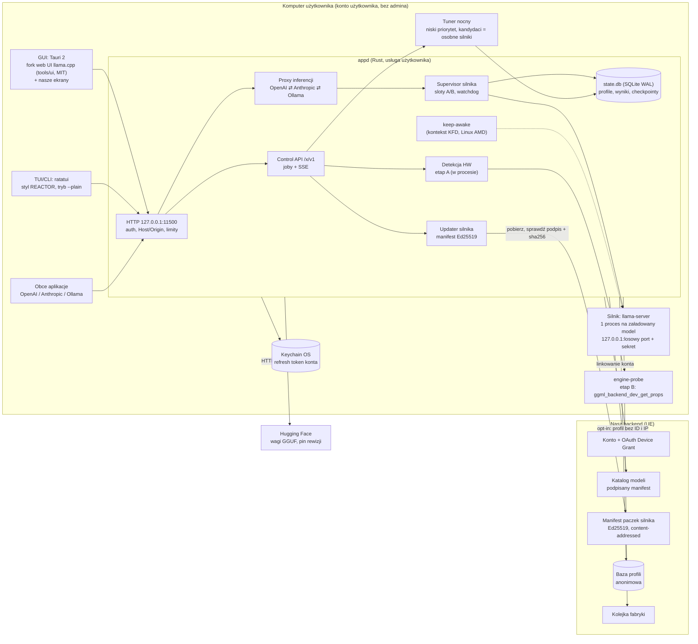
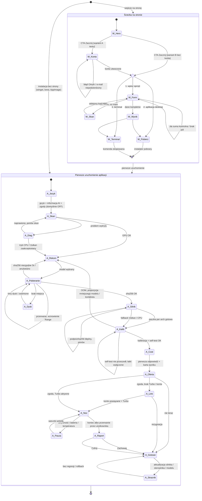
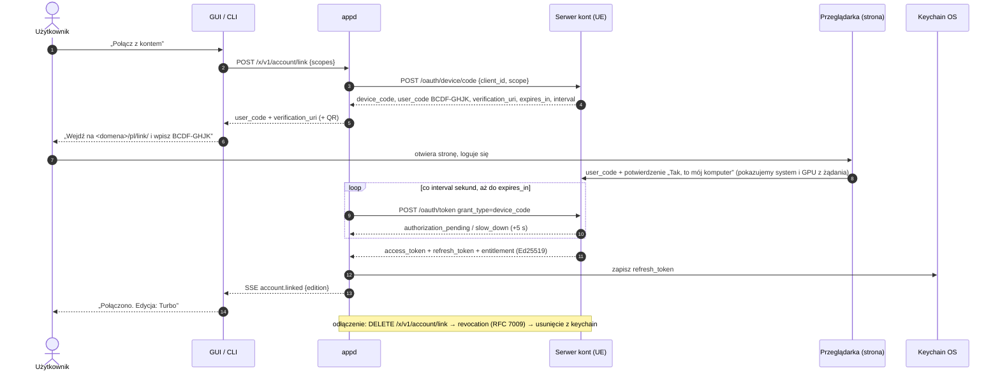

# APP-ARCHITECTURE: architektura aplikacji desktop + lokalnego API

> Status: projekt (2026-10-16). Dokument opisuje aplikację, którą prototypujemy w `~/KERNEL/app/`. Nazwa produktu jest otwartą decyzją: w kodzie zawsze `BRAND.name` (`landing/src/lib/brand.ts`), tutaj `<App>`; identyfikator katalogów i binarki CLI to `<app-id>` / `app` (wyprowadzane z marki przy jej ustaleniu).
>
> Konwencje: `(PLAN §x)` = `~/KERNEL/product/PLAN.md`, `(R03 §x)` = `product/research/03-silniki-i-stack.md`, analogicznie R04, R06, R13. Liczby zmierzone pochodzą wyłącznie z rejestru `landing/src/lib/data/measurements.ts` (źródła: `qwen-opt/NOTES.md`, `STATUS-NEXT.md`). Wartości projektowe, których nikt nie zmierzył, są oznaczone `[SZACUNEK]`.

## Spis treści
1. [Process model](#1-process-model)
2. [API surface](#2-api-surface) (port domyślny 11500 — o nim mówi komentarz w `brand.ts`)
3. [Onboarding state machine](#3-onboarding-state-machine)
4. [Account ↔ app linking](#4-account--app-linking)
5. [Data stored locally vs sent](#5-data-stored-locally-vs-sent)
6. [Error states](#6-error-states)
7. [Honest measurement protocol in the UI](#7-honest-measurement-protocol-in-the-ui)
8. [Open questions / risks](#8-open-questions--risks)

---

## 1. Process model

### 1.1 Zasady
- **Jeden właściciel stanu:** `appd` (Rust) jest jedynym procesem, który zna stan instalacji, trzyma bazę `state.db`, rozmawia z siecią i uruchamia silnik. GUI, TUI/CLI i obce aplikacje to **cienkie klienty** jednego API HTTP (PLAN §4, R03 §3.5).
- **Silnik poza daemonem:** `llama-server` z naszej paczki działa jako proces potomny. Crash silnika nie zabija daemona, a podmiana paczki nie wymaga restartu daemona (R03 §3.2).
- **Bez uprawnień administratora, nigdy root:** daemon jest usługą użytkownika z autostartem, nie usługą systemową (R03 §3.5). Nie zapisujemy niczego do sysfs, rejestru TDR, ustawień sterownika ani `iogpu.wired_limit_mb` (R04 §3.1, R06 §2.1.4). Jeśli naprawa wymaga roota, pokazujemy instrukcję i komendę do skopiowania.
- **Na komputerze użytkownika nigdy:** agenci LLM, kompilacja kodu, zmiany numeryki bez zgody (PLAN §4.3).
- **Silnik nigdy nie jest wystawiony bezpośrednio:** słucha na losowym porcie loopback z sekretem generowanym przy każdym starcie; ruch idzie wyłącznie przez proxy w `appd` (decyzja tego dokumentu, wzór: TensorFold losuje port i klucz, R03 §2.7).

### 1.2 Diagram komponentów



### 1.3 Procesy

| Proces | Uprawnienia | Czas życia | IPC | Obsługa awarii |
|---|---|---|---|---|
| **`appd`** (Rust) | użytkownik; Linux: grupa `render`/`video` potrzebna tylko dla ROCm/KFD (R04 §3.1); Windows bez UAC; macOS bez uprawnień specjalnych | sesja logowania; autostart: Linux `systemd --user`, macOS LaunchAgent, Windows wpis HKCU Run + zadanie harmonogramu przy logowaniu (R03 §3.5); jedna instancja (plik blokady) | serwer HTTP na `127.0.0.1:11500` (konfigurowalny, fallback na kolejny wolny port zapisany w pliku `endpoint`) | restart przez menedżer usług (`Restart=on-failure`, `KeepAlive`); przy starcie odtwarza stan z `state.db` (WAL) i sprząta osierocone silniki po PID-ach zapisanych w bazie |
| **Silnik** `llama-server` | użytkownik; dziedziczy z `appd`; Windows: Job Object z `KILL_ON_JOB_CLOSE`; Linux: `PR_SET_PDEATHSIG` + grupa procesów | od załadowania modelu do wyładowania / bezczynności (domyślnie trzymamy model; wyładowanie po 30 min bezczynności, konfigurowalne `[SZACUNEK]`) | HTTP `127.0.0.1:<losowy>` + `--api-key <sekret per start>`; `/health`, `/metrics`; stdout/stderr do pliku logu | **izolacja:** crash ⇒ restart z backoffem (max 3 w 5 min `[SZACUNEK]`), potem przełączenie na poprzedni slot A/B, potem Vulkan, potem CPU, z komunikatem; **stop:** SIGTERM → po 15 s SIGKILL (llama-server potrafi wisieć na SIGTERM, a następny serwer dzielił VRAM ze starym, NOTES.md:160) i weryfikacja zwolnienia VRAM przed startem kolejnego |
| **Paczki silnika (sloty A/B)** | pliki tylko do odczytu w katalogu danych; podpis Authenticode/notaryzacja każdego pliku wykonywalnego (PLAN §7) | `engine/slot-a`, `engine/slot-b`, wskaźnik `engine/active` zmieniany atomowo (rename) | — | przy każdym starcie sprawdzenie sha256 wobec manifestu; brak lub niezgodność ⇒ ponowne pobranie (scenariusz AV, §6) |
| **`engine-probe`** (etap B detekcji) | użytkownik | jednorazowo: pierwsze uruchomienie, zmiana sterownika/paczki, ręczny re-skan; timeout 30 s, 90 s przy pierwszym uruchomieniu na Windows (R04 §3.1) | stdout JSON | crash/timeout ⇒ backend oznaczony jako niedostępny; GPU z etapu A pokazane jako „nie uruchomimy” z diagnozą (§6) |
| **Tuner** (moduł `appd` + własne instancje silnika) | użytkownik; priorytet niski: `nice 10` / `BELOW_NORMAL_PRIORITY_CLASS` / QoS `utility` `[SZACUNEK]` | tylko w oknie nocnym za zgodą: zasilacz, bezczynność, brak innych kontekstów GPU (PLAN §4.3) | wewnętrzne kanały + zapis kandydatów do `state.db` | **checkpoint** atomowo po każdym kandydacie, wznowienie po crashu/restarcie/resecie sterownika; **TDR-safe:** każdy kandydat ma budżet czasu kernela < 2 s (Windows TDR po 2 s, 5 resetów w 60 s = crash systemu, R06 §2.1.4), na Windows mniejsze rozmiary problemu; kandydat, który spowodował reset/hang ⇒ czarna lista `(build, GPU, sterownik, hash kandydata)`; **limity:** temperatura i moc to progi monitorowane na żywo (odczyt) ⇒ pauza; nie ustawiamy limitów mocy, bo to wymaga roota/admina |
| **Updater aplikacji** | proces GUI (Tauri updater, minisign Ed25519, R03 §2.7) albo menedżer pakietów (winget/brew/apt) dla instalacji tylko-CLI | kanały `stable`/`beta`, wyłącznik auto-update (R06 §2.3.5) | — | przed instalacją: `POST /x/v1/engine/stop` + zamknięcie `appd` (lekcja Jan 0.8.5, R06 §2.3.5); po starcie nowej wersji `appd` robi strażnika regresji (§7) |
| **Updater silnika** (moduł `appd`) | użytkownik; klucz publiczny Ed25519 wkompilowany, feed nienadpisywalny przez env (R03 §3.7) | sprawdzanie przy starcie + co 24 h `[SZACUNEK]` | job + SSE | pobierz do slotu nieaktywnego → podpis + sha256 → kanarek greedy md5 → A/B prędkości wobec aktywnego slotu → przełączenie; niepowodzenie ⇒ slot odrzucony, aktywny bez zmian; regresja po przełączeniu ⇒ **automatyczny rollback** |
| **Detekcja HW** | etap A w `appd`, bez admina, < 300 ms; etap B w `engine-probe`; etap C pomiar 3–10 s po pobraniu modelu (PLAN §4.2, R04 §3.1) | — | — | konflikt A vs B: o „czy uruchomimy” decyduje ggml, o nazwie i sterowniku etap A; odchylenie pomiaru > 50% od tabeli ⇒ diagnoza (R04 §3.1) |
| **keep-awake** (Linux AMD) | użytkownik w grupie `render`; tylko odczyt sysfs | gdy załadowany model na GPU AMD; zwalniany przy wyładowaniu (żeby karta mogła usnąć, gdy niczego nie robimy) | otwarty kontekst KFD (to samo co `gpu-keepawake` z `run-llm.sh`, NOTES.md:125) | brak dostępu do `/dev/kfd` ⇒ komunikat o grupie `render` + opis ręcznego `power/control=on` (§6) |
| **GUI** (Tauri 2) | użytkownik; WebView bez dostępu do sieci poza `appd` (CSP `connect-src` tylko `127.0.0.1:<port>`) | okno + ikona w zasobniku; zamknięcie okna nie zatrzymuje `appd` | HTTP + SSE do `appd`; token czytany przez stronę Rust Tauri z pliku i wstrzykiwany do nagłówków, niedostępny dla `localStorage` | `appd` nie odpowiada ⇒ GUI próbuje go uruchomić i pokazuje stan „Uruchamiam silnik…” |
| **TUI/CLI** `app` (ratatui) | użytkownik | na żądanie; `app daemon` uruchamia `appd` na pierwszym planie (serwery bez GUI) | to samo API; `--json` do skryptów; `--plain` bez ramek dla czytników ekranu (R06 §2.1.6) | jak GUI |

**Detekcja: zakazane źródła** (PLAN §4.2, R04 §3.1, R06 §2.2.1): WMI `AdapterRAM`, parsowanie `nvidia-smi`/`rocm-smi`, `/proc/cmdline`, `dmesg`, logi systemowe, numery seryjne SMBIOS, UUID GPU (NVML/ADLX `UniqueId`), MAC, hostname, nazwa użytkownika. Na Linuksie AMD SMI wyłącznie jako opcjonalny `dlopen` (R13 §7).

**Kolejność źródeł (etap A):** Windows DXGI/DXCore → NVML/ADLX/Level Zero (dynamicznie) → Vulkan → CPUID → `GlobalMemoryStatusEx`; Linux sysfs PCI + `mem_info_vram_total`/`mem_info_gtt_total` + KFD topology → NVML → Level Zero → Vulkan → `/proc/meminfo`; macOS sysctl + Metal `recommendedMaxWorkingSetSize` (R04 §3.1). Wynik etapu A ma ten sam zestaw pól co kod `HW1;…` ze skryptu skanu i formularza na stronie, więc strona i aplikacja liczą rekomendację z tych samych danych.

### 1.4 Silnik: jeden proces na model
- Domyślnie **jeden model rezydentny na GPU**. Drugi model ładujemy obok tylko, gdy oba mieszczą się w budżecie (`budget(hw)` z estymatora minus margines 1 GiB jak `--fit`, R04 §3.2); inaczej poprzedni jest wyładowywany (LRU). `[SZACUNEK]` co do polityki.
- Parametry startu (backend, `--fit`, spekulacja, `ubatch`, wątki, warianty kerneli przez env) pochodzą z **profilu** (podpisany JSON z bazy + wynik kalibracji). Profil to dane, nie kod (PLAN §7).
- Łatki z predykatami (np. `os: [linux]`, `runtime: rocr-kfd`) `appd` włącza przez env tylko tam, gdzie predykat jest spełniony (PLAN §4.5, R13 §6.2).

---

## 2. API surface

### 2.1 Adres, transport, wersjonowanie
- **Adres:** `http://127.0.0.1:11500` (domyślny w prototypie, `BRAND.apiPort`; konfigurowalny). Port wybrany tak, by nie kolidował z 8080, 1234, 1337, 11434, 9931 (R03 §2.7, §3.5). Jeśli zajęty: kolejny wolny, zapisany w pliku `endpoint` obok tokenu.
- **Wersjonowanie:**
  - zgodne API zewnętrzne zachowują ścieżki oryginałów (`/v1/…`, `/api/…`);
  - nasze API kontrolne pod `/x/v1/…`; zmiany łamiące tylko w `/x/v2`; w obrębie v1 wyłącznie zmiany addytywne (nowe pola, nowe endpointy);
  - nagłówek odpowiedzi `X-App-Api: 1.<minor>`; `GET /x/v1/meta` zwraca wersję aplikacji, silnika i listę capabilities;
  - wycofanie endpointu: ogłoszone w changelogu i w `meta.deprecations` co najmniej dwa wydania wcześniej `[SZACUNEK]`.
- **Operacje długie = joby:** `POST` zwraca `202 {"job": {...}}`; stan w `GET /x/v1/jobs/{id}`; anulowanie `DELETE /x/v1/jobs/{id}`; postęp w strumieniu SSE.

### 2.2 Bezpieczeństwo (lekcje z CVE Ollamy, R03 §2.7, R06 §2.2.5)

| Mechanizm | Zachowanie |
|---|---|
| Bind | tylko `127.0.0.1` i `::1`. Inny bind wymaga świadomego włączenia „Tryb sieci lokalnej” w ustawieniach |
| Token | 256 bitów losowych, generowany przy instalacji; plik `api-token` czytelny tylko dla użytkownika (Linux/macOS `0600`, Windows ACL tylko właściciel). Przyjmowany jako `Authorization: Bearer` (OpenAI, Ollama, nasze API) albo `x-api-key` (klienci Anthropic). Porównanie w stałym czasie |
| Zakresy tokenów | **decyzja:** token główny `scope=control+inference` (GUI, CLI) oraz dowolna liczba tokenów `scope=inference` dla obcych aplikacji, nazwanych i odwoływalnych na ekranie „Dla programistów”. `/x/v1/*` wymaga `control` |
| `Host` | dozwolone tylko `127.0.0.1:<port>`, `localhost:<port>`, `[::1]:<port>`; inaczej `421` (ochrona przed DNS rebinding, CVE-2024-28224) |
| `Origin` / CORS | domyślnie żadne `Origin` przeglądarki nie jest dozwolone (preflight `OPTIONS` → `403`), poza originem okna Tauri. Użytkownik może dodać origin (np. własny frontend) w ustawieniach |
| Trusted Hosts (tryb LAN) | bind na interfejs LAN tylko z listą dozwolonych nazw hosta (jak Jan 0.8.5, R06 §2.2.5), tylko `scope=inference`, osobny token LAN; **API kontrolne nigdy poza loopback** |
| Ścieżki | żadnych dowolnych ścieżek w API (Probllama, CVE-2024-37032); modele identyfikowane ID z katalogu albo importem przez okno wyboru pliku w GUI |
| Parsery | GGUF i HTTP w Rust, parser GGUF fuzzowany (Bleeding Llama, CVE-2026-7482) |
| Limity | per token: nieudane uwierzytelnienia 10/min ⇒ `429` z rosnącą karą; zapisy w `/x/v1` 60/min; równoległe generacje = liczba slotów silnika, nadmiar w kolejce lub `429` z `Retry-After` `[SZACUNEK]` |
| Logi | nigdy treści promptów i odpowiedzi; tylko metadane (endpoint, czas, liczba tokenów) lokalnie |

### 2.3 Tabela endpointów

| Metoda i ścieżka | Zakres | Opis | Uwagi |
|---|---|---|---|
| `POST /v1/chat/completions` | inference | OpenAI Chat Completions, `stream: true` = SSE | proxy do silnika; model po `id` z `/v1/models` |
| `POST /v1/responses` | inference | OpenAI Responses | tłumaczone na wywołania silnika |
| `GET /v1/models` | inference | lista modeli zainstalowanych | z polami `owned_by`, `x_license`, `x_fit` |
| `POST /v1/messages` | inference | Anthropic Messages (SSE `message_start…message_stop`) | nagłówek `anthropic-version` akceptowany i ignorowany |
| `POST /api/chat`, `POST /api/generate` | inference | emulacja Ollamy (NDJSON stream) | zasięg integracji znających tylko Ollamę (R03 §3.5) |
| `GET /api/tags`, `POST /api/show` | inference | lista / szczegóły modeli w formacie Ollamy | `/api/pull`, `/api/create` **nie są emulowane** (wektor CVE); pobieranie tylko przez `/x/v1/models/*` |
| `GET /x/v1/meta` | control | wersje, capabilities, deprecations | bez auth tylko `{"api":"x/v1"}` (do wykrycia daemona) |
| `GET /x/v1/events` | control | **SSE**: joby, telemetria, stan silnika, alerty | `?topics=jobs,telemetry,engine,alerts`; `Last-Event-ID` |
| `GET /x/v1/hardware` | control | wynik detekcji A+B(+C) | to, co widać na „Mój komputer” |
| `POST /x/v1/hardware/rescan` | control | ponowny skan (job) | |
| `GET /x/v1/hardware/scan-code` | control | linia `HW1;…;sum=XXXX` | ta sama co ze skryptu skanu, do wklejenia na stronie |
| `GET /x/v1/models/catalog` | control | katalog z etykietą `fits/tight/slow/no`, licencją, przedziałem prędkości | z podpisanego manifestu (PLAN §4.2) |
| `GET /x/v1/models` | control | zainstalowane modele + stan weryfikacji | |
| `POST /x/v1/models/{id}/download` | control | pobieranie (job): wznowienie Range, sha256, pin rewizji | sprawdza wolne miejsce przed startem |
| `POST /x/v1/models/{id}/verify` | control | ponowna weryfikacja sha256 (job) | |
| `DELETE /x/v1/models/{id}` | control | usunięcie wag | |
| `POST /x/v1/models/import` | control | import własnego GGUF („zaawansowane”, R06 §2.2.5) | tylko z GUI/CLI z lokalnym wyborem pliku; ścieżka nie przychodzi z sieci |
| `GET /x/v1/engine` | control | stan silników, aktywny slot, backend, „liczy na GPU” | |
| `POST /x/v1/engine/start`, `/stop` | control | ładowanie / wyładowanie modelu | |
| `POST /x/v1/calibration` | control | szybka kalibracja L0+L1 (job, 1–5 min, PLAN §4.3) | |
| `POST /x/v1/tuning` | control | start nocy (job) z warunkami | wymaga Turbo (PLAN §8) |
| `POST /x/v1/tuning/pause`, `/resume` | control | pauza / wznowienie | auto-pauza też przy aktywności |
| `GET /x/v1/tuning` | control | postęp, ETA, najlepszy dotąd, temperatury | |
| `POST /x/v1/tuning/undo` | control | powrót do profilu sprzed nocy | dziennik zmian zostaje |
| `GET /x/v1/results`, `GET /x/v1/results/{id}` | control | historia pomiarów | |
| `GET /x/v1/results/{id}/report` | control | raport JSON (schemat §7.4); `Accept: text/html` = wersja HTML | do pobrania dla recenzentów |
| `GET /x/v1/profiles`, `POST /x/v1/profiles/{id}/activate` | control | profile (bazowy, po kalibracji, po nocy, „Tryb maksymalny”) | aktywacja = restart silnika |
| `GET/PATCH /x/v1/settings` | control | ustawienia, w tym przełączniki zgody | zmiana zgody zapisuje datę i wersję tekstu zgody |
| `GET /x/v1/settings/consent/preview` | control | **„Pokaż, co wysłalibyśmy”**: dokładny JSON | §5.3 |
| `GET /x/v1/tokens`, `POST /x/v1/tokens`, `DELETE /x/v1/tokens/{id}` | control | tokeny `inference` dla obcych aplikacji | |
| `POST /x/v1/account/link` | control | start Device Grant (§4) | zwraca `user_code` |
| `GET /x/v1/account`, `DELETE /x/v1/account/link` | control | stan powiązania / odłączenie | |
| `GET /x/v1/updates`, `POST /x/v1/updates/engine/apply`, `POST /x/v1/updates/engine/rollback` | control | stan aktualizacji, ręczne zastosowanie, ręczny rollback | |
| `GET /x/v1/jobs/{id}`, `DELETE /x/v1/jobs/{id}` | control | stan / anulowanie joba | |

### 2.4 Szkice żądań i odpowiedzi

```http
GET /x/v1/hardware
Authorization: Bearer <token>
```
```json
{
  "os": {"family": "linux", "version": "6.8.0-138-generic"},
  "gpus": [{
    "index": 0, "vendor": "amd", "name": "Radeon RX 7900 XTX", "arch": "gfx1100",
    "vram_gib": 24.0, "driver": "amdgpu 6.8.0-138-generic", "pcie": "4x16",
    "backends": {"vulkan": "ok", "rocm": "ok", "cuda": "absent"},
    "runnable": true, "source": {"inventory": "sysfs", "probe": "ggml"}
  }],
  "cpu": {"threads": 16, "isa": "avx2"},
  "ram_gib": 62.7,
  "power": {"ac": true, "chassis": "desktop"},
  "warnings": [],
  "scan_code": "HW1;os=linux;gpu=…;sum=…"
}
```

```http
POST /x/v1/models/qwen3.8-27b-ud-q4_k_xl/download
```
```json
{"job": {"id": "j_7f3a", "kind": "download", "state": "running",
         "bytes_total": null, "bytes_done": 0, "resume": true, "sha256": "pending"}}
```

```http
POST /x/v1/tuning
```
```json
{"window": "idle_and_ac", "quiet": false, "max_junction_c": "profile", "allow_numerics_change": false}
```
```json
{"job": {"id": "j_91c2", "kind": "tuning", "state": "waiting_for_idle",
         "conditions": {"ac": true, "idle": false, "gpu_free": true}}}
```

Strumień SSE (`GET /x/v1/events?topics=jobs,telemetry,alerts`):
```text
id: 1042
event: job.progress
data: {"job":"j_91c2","step":3,"steps":5,"candidate":42,"candidates":180,"eta_s":7800,"best_so_far":{"tps_median":null,"significant":false}}

id: 1043
event: telemetry.gpu
data: {"gpu":0,"power_w":284,"junction_c":87,"edge_c":67,"mem_c":84,"fan_rpm":1850,"vram_used_gib":21.9,"gtt_used_gib":0.1,"runtime_status":"active"}

id: 1044
event: alert
data: {"code":"gpu_sleep_detected","severity":"warn","action":"keepawake_enabled"}
```
> Liczby w przykładach SSE: przykład układu. Telemetria GPU skopiowana z obserwacji w NOTES.md:146 i :170; licznik kandydatów i ETA to przykład z tabeli UX w R06 §2.1.4; `vram_used_gib` jest ilustracyjne.

Zdarzenia: `job.progress`, `job.done`, `job.failed`, `engine.state` (`loading|ready|crashed|stopped`, `backend`, `on_gpu`), `telemetry.gpu` (1 Hz, tylko gdy ktoś subskrybuje), `alert` (kody z §6), `update.available`, `consent.changed`. Bufor ostatnich zdarzeń w pamięci pozwala na wznowienie po `Last-Event-ID`.

---

## 3. Onboarding state machine

Dwie ścieżki: strona (PLAN §8.1.1) i pierwsze uruchomienie aplikacji (PLAN §3.2). Obie kończą się w tym samym stanie „aplikacja gotowa”, a konto nie jest warunkiem działania aplikacji (§4).



### 3.1 Stany: opis, wyjście, dane zapisane

| Stan | Co widzi użytkownik | Warunek wyjścia | Dane zapisane |
|---|---|---|---|
| `W_Hero` | hero + animacja prędkości (z pauzą), liczby z rejestru `M` z podpisem karta/model/metoda | klik CTA | nic (cookies tylko za zgodą, PLAN §8.1) |
| `W_Konto` | rejestracja: e-mail / Google / GitHub, regulamin + polityka, zgoda marketingowa osobno | konto aktywne; w wariancie B testu stan pomijany | serwer: e-mail, dostawca logowania, data i wersja akceptacji regulaminu |
| `W_Wybor` | trzy drogi | wybór | nic |
| `W_Form` | pola GPU/VRAM/RAM/system z podpowiedziami z `gpus.json` | kod `HW1` z poprawną sumą albo komplet pól | lokalnie w przeglądarce (`sessionStorage`); na koncie tylko po kliknięciu „Zapisz sprzęt” |
| `W_Skan` | komenda do skopiowania (PowerShell / bash / macOS), link do kodu źródłowego; skrypt nic nie wysyła | użytkownik wkleja kod | nic |
| `W_Wynik` | polecany model, przewidywana prędkość **jako przedział** z estymatora (`decodeRange`), a zmierzona tylko gdy `measuredFor` ma wpis; nieznane kombinacje = uczciwy przedział (PLAN §8.1.1) | wybór pobrania / terminala | na koncie: kategorie sprzętu, jeśli zapisane |
| `W_Pobierz` / `W_Terminal` | podpisany instalator dla wykrytego systemu / `winget`, `brew`, `curl … \| sh` z sumą i podpisem | pobrano / skopiowano | nic |
| `A_Jezyk` | język PL/EN, informacja „rozmawiasz z AI” (AI Act art. 50(1), PLAN §7), trzy przełączniki zgody **wyłączone** (§5), „Co wiemy o komputerze” | „Dalej” | `settings.lang`, `settings.consent.*` z datą i wersją tekstu |
| `A_Skan` | skan etapu A (< 300 ms) + etap B w podprocesie z paskiem postępu | etap B zakończony lub timeout | `hardware` w `state.db` (kategorie, bez identyfikatorów) |
| `A_Diag` | konkretny problem z tabeli §6 i jedna główna akcja | naprawione (ponowny skan) albo akceptacja trybu zastępczego | `diagnostics` (kod, data, decyzja) |
| `A_Rekom` | 1 model główny + 2 alternatywy (szybszy / mądrzejszy / po polsku), licencja, rozmiar, etykieta pasowania, przedział prędkości | wybór modelu | `selection` (model, kwant, kontekst) |
| `A_Pobieranie` | rozmiar, czas, postęp; wznawianie; weryfikacja sha256, pin rewizji HF | sha256 zgodne | plik `.part` + offset w `downloads`; po weryfikacji wpis w `models` |
| `A_Dysk` | ile potrzeba, ile wolne, wybór innego katalogu | wystarczające miejsce | `settings.models_dir` |
| `A_Silnik` | „Pobieram silnik dla Twojej karty” | podpis Ed25519 manifestu + sha256 plików OK, slot aktywny | `engine/slot-*`, `engine/active` |
| `A_Kalib` | 1–5 min: naprawy L0, `--fit` z testem pełnego kontekstu, wybór backendu i paczki, koszt kroku spekulacji, self-test logitów, baseline A/A (PLAN §4.3) | profil bazowy zapisany | `profiles` (bazowy), `results` (baseline, σ z A/A), md5 kanarków |
| `A_Czat` | pierwsza rozmowa + karta wyniku (3 liczby, §7) | pierwsza odpowiedź zakończona | nic z treści rozmowy poza lokalną historią czatu (jeśli użytkownik jej nie wyłączy) |
| `A_Oferta` | „Zostaw na noc, dostroimy pod Twój komputer” | decyzja | `settings.overnight` |
| `A_Link` | Device Grant (§4) | powiązane z Turbo albo rezygnacja | refresh token w keychain, `account` (ID konta, edycja) |
| `A_Noc` / `A_Pauza` | postęp, ETA, temperatura, „najlepszy dotąd”, pauza (R06 §2.1.4) | koniec, przerwanie, brak warunków | `tuning_checkpoints` po każdym kandydacie, `blacklist` |
| `A_Raport` | karta „przed → po” + Zachowaj / Cofnij + dziennik zmian | decyzja | `profiles` (nocny), `results`, `changelog` |
| `A_Gotowe` | normalna praca | — | — |
| `A_Straznik` | dyskretny pasek „Sprawdzam, czy po aktualizacji nadal jest tak samo szybko i poprawnie” | re-pomiar zakończony | `results` (regresja tak/nie), ewentualny rollback w `changelog` |

---

## 4. Account ↔ app linking

### 4.1 Zasady
- **Offline-first:** aplikacja działa w pełni bez konta: skan, rekomendacja, pobieranie, kalibracja L0+L1, gotowe profile L3, czat, lokalne API (edycja Free, PLAN §8). Konto jest potrzebne tylko do: synchronizacji wyników ze stroną, edycji Turbo (noc L2, re-tuning, Tryb maksymalny, priorytet w kolejce fabryki).
- **Powiązanie:** OAuth 2.0 Device Authorization Grant (RFC 8628). Aplikacja i CLI nie mają pola na hasło ani wbudowanej przeglądarki logowania; logowanie dzieje się na naszej stronie, w przeglądarce użytkownika.
- **Tokeny:**
  - refresh token (rotowany przy każdym użyciu) w keychainie systemu: Windows Credential Manager, macOS Keychain, Linux libsecret (Secret Service). Gdy na Linuksie nie ma Secret Service (np. serwer bez sesji graficznej), **nie zapisujemy tokenu na dysku**: powiązanie trwa do restartu `appd`, a CLI to komunikuje (decyzja; alternatywa w §8);
  - access token krótkożyjący (15 min `[SZACUNEK]`), tylko w pamięci `appd`;
  - uprawnienie Turbo jako **podpisany Ed25519 certyfikat uprawnień** (konto, edycja, data ważności) cache'owany lokalnie, ważny offline przez 30 dni `[SZACUNEK]`, żeby noc działała bez sieci.
- **Zakresy:** `results:sync`, `hardware:sync`, `edition:read`. Synchronizacja wyników jest osobnym polem wyboru na ekranie powiązania (domyślnie zaznaczone tylko `edition:read`; `results:sync` i `hardware:sync` wybiera użytkownik).

### 4.2 Sekwencja powiązania



Szczegóły:
- `user_code`: 8 znaków z alfabetu spółgłosek bez samogłosek, w formacie `XXXX-XXXX` (zalecenie RFC 8628 §6.1); ważność 10 min `[SZACUNEK]`; `interval` 5 s (domyślny w RFC 8628).
- **Ochrona przed phishingiem kodu** (RFC 8628 §5.4): strona przed potwierdzeniem pokazuje, co próbuje się podłączyć (system, nazwa GPU z żądania, czas żądania), a nie tylko pole na kod. `verification_uri_complete` (z kodem w URL, pod QR) wymaga mimo to kliknięcia „Potwierdź”.
- Urządzenie widoczne na koncie jako „Komputer 1 (Linux, RX 7900 XTX)” z nazwą nadaną przez użytkownika; nigdy hostname.

### 4.3 Co przechowuje konto, a czego nigdy

| Na koncie (serwer, UE) | Nigdy |
|---|---|
| e-mail, dostawca logowania, wersje zaakceptowanego regulaminu/polityki, zgoda marketingowa (osobna, podwójny opt-in) | treść promptów, czatów, plików, własnych promptów testowych |
| edycja (Free/Turbo) i status płatności (dane karty u operatora płatności, nie u nas) | hostname, nazwa użytkownika, ścieżki, numery seryjne, UUID GPU, MAC |
| lista powiązanych urządzeń: nazwa nadana przez użytkownika, kategorie sprzętu (`hardware:sync`) | lista zainstalowanych aplikacji / plików |
| wyniki „przed → po” i historia optymalizacji (`results:sync`) | logi silnika, telemetria w czasie rzeczywistym |
| zgłoszenia nieznanej kombinacji powiązane z kontem tylko po to, by odesłać przepis (PLAN §8.1.1) | lokalizacja / geolokacja IP |

Anonimowy profil społeczności (§5) **nigdy** nie jest łączony z kontem, nawet gdy konto istnieje.

### 4.4 Odłączenie i usunięcie konta
- **Odłączenie w aplikacji:** odwołanie refresh tokenu na serwerze, usunięcie z keychain, usunięcie certyfikatu Turbo. Dane lokalne (modele, profile, wyniki) zostają. Funkcje Turbo przestają działać; profil nocny zostaje aktywny, bo jest już lokalny i był zweryfikowany (decyzja).
- **Usunięcie konta na stronie** (jeden przycisk, PLAN §8.1.1): usuwa dane konta i odwołuje wszystkie tokeny. Aplikacja przy kolejnym odświeżeniu dostaje `invalid_grant` i pokazuje „Konto zostało odłączone. Aplikacja działa dalej w wersji Free.” bez utraty danych lokalnych.
- **Usunięcie danych lokalnych:** w ustawieniach „Usuń wszystkie dane aplikacji” oraz deinstalator z pytaniem, czy zostawić modele (wielogigabajtowe pliki).

### 4.5 Ryzyko: konto przed pobraniem (PLAN §8.1.1)
Obowiązkowe konto przed pobraniem obniża liczbę instalacji. Architektura wspiera oba warianty bez zmian w aplikacji, bo aplikacja zawsze działa bez konta:
- **Wariant A:** CTA → konto → wybór drogi (jak w PLAN §8.1.1).
- **Wariant B:** CTA → wybór drogi bez konta; konto proponowane przy pierwszej optymalizacji (`A_Oferta` → `A_Link`) albo przy „Zapisz wynik” na stronie.
- Mierzymy na stronie wyłącznie zdarzenia zgodne z polityką cookies (bez cookies analitycznych bez zgody); wskaźnik: odsetek osób, które doszły do `A_Czat`, mierzymy tylko u tych, którzy połączyli konto, więc test A/B wymaga ostrożnej interpretacji (bias). Do decyzji przed testem (§8).

---

## 5. Data stored locally vs sent

### 5.1 Lokalizacje
- **Linux:** konfiguracja `$XDG_CONFIG_HOME/<app-id>/` (`settings.json`, `api-token`, `endpoint`), dane `$XDG_DATA_HOME/<app-id>/` (`state.db`, `models/`, `engine/`), logi `$XDG_STATE_HOME/<app-id>/logs/`, cache `$XDG_CACHE_HOME/<app-id>/`.
- **Windows:** konfiguracja `%APPDATA%\<App>\`, dane, modele, silnik i logi `%LOCALAPPDATA%\<App>\` (nie roamują), cache `%LOCALAPPDATA%\<App>\Cache\`.
- **macOS:** `~/Library/Application Support/<app-id>/` (konfiguracja, `state.db`, silnik, modele), `~/Library/Logs/<app-id>/`, `~/Library/Caches/<app-id>/`.
- Katalog modeli konfigurowalny (także wspólny z innymi narzędziami, R06 §2.1.5).

### 5.2 Tabela danych

| Dane | Gdzie lokalnie | Retencja lokalna | Czy kiedykolwiek wysyłane? | Pod jakim przełącznikiem |
|---|---|---|---|---|
| Prompty, odpowiedzi, historia czatu | `state.db` (tabela `chats`), opcja „nie zapisuj historii” | do usunięcia przez użytkownika | **nigdy** | — |
| Własne prompty testowe (do pomiaru/strojenia draftu) | `state.db` | do usunięcia | **nigdy**; do chmury idą tylko liczby (PLAN §4.3) | — |
| Kategorie sprzętu (OS, GPU, VRAM, sterownik major.minor, CPU ISA, RAM, PCIe) | `state.db` `hardware` | do re-skanu | tak, w kategoriach | przełącznik 2 lub 3; albo `hardware:sync` na koncie |
| Identyfikatory (serial, UUID GPU, MAC, hostname, użytkownik, ścieżki) | **nie są odczytywane** | — | nigdy | — |
| Telemetria na żywo (temperatury, moc, zegary, `runtime_status`) | pamięć `appd` + skrót w wynikach pomiaru | w wynikach: do usunięcia | tylko podsumowanie (mediana temp. w pomiarze) w profilu | przełącznik 2 |
| Wyniki pomiarów i raporty | `state.db` `results` | do usunięcia; raport JSON tylko gdy pobrany | tak | przełącznik 2 (anonimowo) albo `results:sync` (konto) |
| Profile (parametry silnika) | `state.db` `profiles` | do usunięcia | tak, jako część profilu | przełącznik 2 |
| Checkpointy nocy, czarna lista | `state.db` | 90 dni `[SZACUNEK]` | czarna lista tylko jako kandydat + kod błędu | przełącznik 2 |
| Raport o awarii (stack trace silnika/appd, wersje, kod błędu) | `logs/crash-*.json` | 30 dni `[SZACUNEK]` | tak, **po pytaniu przy każdej awarii** z podglądem | przełącznik 1 |
| Zgłoszenie nieznanej kombinacji | — | — | tak (kategorie sprzętu + model + wynik baseline) | przełącznik 3 |
| Logi `appd`/silnika (bez treści) | `logs/` | rotacja 7 dni `[SZACUNEK]` | tylko jako załącznik raportu awarii, po podglądzie | przełącznik 1 |
| Token API, tokeny `inference` | plik `0600` / ACL | do odwołania | nigdy | — |
| Refresh token konta | keychain OS | do odłączenia | tylko do serwera kont (OAuth) | powiązanie konta |
| Zapytania o aktualizacje i katalog | — | — | tak: wersja aplikacji/silnika + platforma (bez ID) | konieczne do aktualizacji bezpieczeństwa (R06 §2.2.4); można wyłączyć auto-update i tryb „offline” |
| Statystyki użycia | — | — | **nie zbieramy wcale** (R06 §2.2.2) | — |

### 5.3 Trzy przełączniki zgody (wszystkie domyślnie **wyłączone**)
1. **„Wyślij raport o awarii”**: pytanie przy każdej awarii, z podglądem i opcją „zawsze pytaj / nigdy” (R06 §2.2.2).
2. **„Udostępnij mój profil przyspieszenia społeczności”**: anonimowy JSON poniżej, po każdej udanej kalibracji/nocy, z opóźnieniem losowym do 24 h `[SZACUNEK]`, żeby czas wysłania nie korelował z sesją.
3. **„Zgłoś nieznaną kombinację do fabryki”**: gdy nie mamy profilu dla (GPU × model) (PLAN §4 diagram, §4.3). Jeśli konto jest powiązane, użytkownik może osobno zaznaczyć „powiadom mnie, gdy przepis będzie gotowy”, co łączy zgłoszenie z kontem (jawnie).

Każda zmiana zgody zapisuje datę i wersję tekstu zgody. Przyjmowanie po stronie serwera: **odrzucenie IP przy ingest** (reverse proxy nie loguje IP dla endpointu profili), brak cookies, brak ID instalacji, agregacja (PLAN §7, R06 §2.2.2). Retencja raportów awarii 90 dni (R06 §2.2.2).

**„Pokaż, co wysłalibyśmy”** (R06 §2.2.1): przycisk przy każdym przełączniku i na ekranie „Mój komputer”; wywołuje `GET /x/v1/settings/consent/preview` i pokazuje dokładnie ten bajtowy JSON, który poszedłby w sieć (ten sam serializator, bez osobnej „ładnej” wersji).

### 5.4 Przykład anonimowego profilu (przełącznik 2)

```json
{
  "schema": "profile-share/1",
  "app": "0.1.0",
  "engine": {"build": "ours-<tag>-<hash>", "backend": "vulkan", "slot_manifest_seq": 0},
  "os": {"family": "linux", "kernel_major_minor": "6.8"},
  "gpu": {"vendor": "amd", "model": "Radeon RX 7900 XTX", "arch": "gfx1100", "vram_gib": 24, "driver": "amdgpu", "driver_major_minor": "6.8", "pcie": "4x16"},
  "cpu": {"isa": "avx2", "threads_bucket": "16"},
  "ram_gib_bucket": 64,
  "model": {"id": "qwen3.8-27b", "quant": "UD-Q4_K_XL", "gguf_sha256": "<sha256 pliku z katalogu>", "ctx": 32768},
  "params": {"spec": "mtp", "draft_n": 3, "ubatch": 512, "kv": "f16", "kernel_variants": ["<id>"], "patch_switches": {"<id>": true}},
  "result": {
    "harness": "abba/1", "pairs": 5, "warmup": true,
    "decode_tps_median_before": 85.6, "decode_tps_median_after": 109.0,
    "interval_after": null,
    "aa_sigma": null,
    "significant": null,
    "greedy_md5_before": "6f14e814…", "greedy_md5_after": "6f14e814…",
    "md5_gate": "pass", "kld": null,
    "junction_c_median": 87, "on_ac": true
  }
}
```
Brak pól: IP (odrzucane przy ingest), ID instalacji, ID konta, hostname, serial, czas lokalny (tylko data wysłania po stronie serwera), prompty. Kubełki (`threads_bucket`, `ram_gib_bucket`, zaokrąglone VRAM) zmniejszają ryzyko fingerprintingu (R06 §2.2.1, EDPB 2/2023).
> Liczby w przykładzie: przykład formatu. 85.6 i 109.0 t/s to nasze pomiary laboratoryjne (rejestr `M`: upstream Vulkan + MTP n=4 i nasz silnik MTP; inne buildy i harnessy, więc to nie jest para „przed → po” jednego pomiaru), 87 °C z NOTES.md:170, `draft_n`, `ubatch`, `ctx` ilustracyjne. `interval_after` i `aa_sigma` są `null`, bo danych z kalibracji ABBA jeszcze nie ma. md5 prefiks MTP z rejestru `MD5`.

---

## 6. Error states

Zasady: komunikat mówi, co się stało, co zrobiliśmy i co może zrobić użytkownik; jedna główna akcja; nigdy nie instalujemy sterowników sami (R06 §2.1.5); nigdy nie zapisujemy sysfs/rejestru jako root/admin. **Telemetria dla wszystkich wierszy: brak**, chyba że przełącznik 1 (raport awarii, po podglądzie) lub 3 (nieznana kombinacja) jest włączony. Lokalnie każdy błąd trafia do `diagnostics` i na ekran „Mój komputer”.

| Błąd | Detekcja | Komunikat PL / EN | Akcja automatyczna |
|---|---|---|---|
| **Brak lub za stary sterownik** | wersja sterownika z etapu A vs minimum backendu w manifeście (np. CUDA 13 wymaga CC ≥ 7.5 i R580+, R03 §3.6) | PL: „Twoja karta działa, ale sterownik jest za stary dla najszybszego trybu. Działamy w trybie zgodności. [Pokaż, jak zaktualizować]” / EN: „Your graphics card works, but its driver is too old for the fastest mode. We're running in compatibility mode. [Show me how to update]” | fallback: CUDA 12 → Vulkan → CPU; instrukcja producenta; ponowny skan po aktualizacji |
| **GPU niewidoczne / fallback na CPU** | etap A widzi GPU, etap B nie (brak `vulkan-1.dll`/loadera, brak dostępu do `/dev/kfd` lub `renderD*`, crash probe) | PL: „Widzimy kartę {gpu}, ale nie możemy jej użyć. Model liczy teraz na procesorze, więc będzie wolniej. [Napraw]” / EN: „We can see your {gpu} but can't use it yet. The model is running on the CPU for now, so it will be slower. [Fix it]” | wskaźnik „liczy na GPU” zmienia się na „liczy na CPU”; Linux: instrukcja „dodaj się do grupy `render`” (bez sudo w aplikacji, R04 §3.1); rekomendacja przeliczona dla CPU |
| **OOM VRAM** | estymator + `llama_params_fit` przed startem; błąd alokacji backendu w trakcie | PL: „Ten model się nie zmieści w pamięci karty. Proponuję mniejszą wersję albo krótszą pamięć rozmowy.” / EN: „This model won't fit in your graphics memory. Try a smaller version or a shorter conversation memory.” | propozycja mniejszego kwantu lub `ctx` z `CTX_OPTIONS`; nigdy start, który zawiesi system |
| **OOM RAM** | `RAM wolny` vs wagi na CPU / MoE offload przed startem; sygnał zabicia silnika przez OOM killera (Linux: kod wyjścia 137) | PL: „Komputerowi zabrakło pamięci RAM. Zamknij część programów albo wybierz mniejszy model.” / EN: „Your computer ran out of memory. Close some apps or pick a smaller model.” | restart z mniejszym kontekstem; brak automatycznej pętli restartów |
| **NVIDIA Windows sysmem fallback** (cicho 5–30× wolniej, PLAN §4.5) | budżet `QueryVideoMemoryInfo`, limit = budżet − 1 GiB; w trakcie `NON_LOCAL CurrentUsage` rośnie (R04 §3.1); **live speed check:** dekodowanie < 50% mediany z kalibracji przez 3 kolejne odpowiedzi `[SZACUNEK]` | PL: „Karta zaczęła używać pamięci RAM zamiast własnej, przez co pisze kilka razy wolniej. Zmniejszyliśmy pamięć rozmowy, żeby to naprawić.” / EN: „Your card started borrowing system RAM instead of its own memory, which makes it several times slower. We reduced the conversation memory to fix it.” | restart z mniejszym `ctx` / jawnym `-ngl`, żeby zmieścić się w budżecie; instrukcja wyłączenia „CUDA – Sysmem Fallback Policy” w panelu NVIDIA (nie zmieniamy sami) |
| **AMD BACO / runtime PM** (4.4 vs 92 t/s, NOTES.md:122–126) | Linux: odczyt `power/runtime_status` = `suspended`, `mem_info_vram_used` spada, `mem_info_gtt_used` rośnie; pomiar < 10% oczekiwanego (R04 §3.1) | PL: „Karta usypiała się między odpowiedziami i model trafiał do zwykłej pamięci. Naprawiliśmy to: dopóki model jest załadowany, karta nie zaśnie.” / EN: „Your card kept going to sleep between replies and the model was moved to system memory. Fixed: the card stays awake while a model is loaded.” | keep-awake przez otwarty kontekst KFD na czas załadowania modelu; **nigdy** zapis `power/control` jako root; gdy brak dostępu do KFD: komunikat z grupą `render` i opisem ręcznego `power/control=on` do wykonania przez użytkownika |
| **TDR / reset GPU** | Windows: utrata urządzenia w backendzie (`VK_ERROR_DEVICE_LOST`, `cudaErrorLaunchTimeout` itp.), crash silnika; Linux: analogiczne kody backendu (dmesg **nie** czytamy) | PL: „Karta graficzna się zrestartowała. Wyłączyliśmy ostatnią zmianę i wróciliśmy do poprzednich ustawień.” / EN: „Your graphics card restarted. We turned off the last change and went back to the previous settings.” | w nocy: kandydat na czarną listę, wznowienie od checkpointu; w normalnej pracy po zmianie profilu: rollback profilu; 2 resety w 10 min ⇒ wstrzymanie strojenia do jutra `[SZACUNEK]` (daleko od limitu 5 w 60 s) |
| **Antywirus poddał plik kwarantannie** | brak lub zły sha256 pliku silnika przy starcie (R06 §2.1.5) | PL: „Program antywirusowy omyłkowo zablokował plik silnika. [Napraw jednym kliknięciem]” / EN: „Your antivirus blocked an engine file by mistake. [Fix it in one click]” | ponowne pobranie podpisanego pliku + weryfikacja sha256; link do zgłoszenia false positive; po 2 kolejnych kwarantannach instrukcja dodania wyjątku (nie dodajemy sami) |
| **Przerwane pobieranie** | HTTP Range + sha256 (R06 §2.1.5) | PL: „Wznawiam pobieranie od {pct}%.” / EN: „Resuming download from {pct}%.” | resume; po 3 niezgodnych sha256 — usunięcie `.part` i start od zera z innego mirrora |
| **Brak miejsca** | wolne miejsce przed pobraniem i przed rozpakowaniem paczki | PL: „Potrzebujemy {need} GB, a na {drive} jest {free} GB. [Wybierz inny dysk]” / EN: „We need {need} GB but {drive} only has {free} GB free. [Choose another drive]” | wybór katalogu modeli; nie zaczynamy pobierania |
| **WSL2 + ROCm** | obecny `/dev/dxg`, brak `/dev/kfd` (R13 §6) | PL: „Działasz w WSL2. Używamy trybu zgodnego z WSL; część przyspieszeń dla kart AMD jest tu niedostępna.” / EN: „You're running in WSL2. We're using a WSL-compatible mode; some AMD speed-ups aren't available here.” | predykat `runtime: rocr-kfd` niespełniony ⇒ łatka PM4 (0060) **wyłączona** (inaczej cicho pomijana, wyniki byłyby śmieciowe); domyślnie Vulkan (jak ROCm CLI); watchdog na znany hang XTX przy asercjach urządzenia |
| **Throttling termiczny** | temperatura junction blisko limitu producenta + spadek zegarów (odczyt hwmon / NVML / ADLX / macOS `thermalState`) | PL: „Karta jest bardzo gorąca i zwalnia. Wstrzymaliśmy pomiary, dopóki się nie schłodzi.” / EN: „Your card is running very hot and slowing down. We've paused measurements until it cools.” | pauza nocy i pomiarów; wynik zrobiony w throttlingu oznaczony i nieporównywany. Uwaga: na naszym 7900 XTX junction 85–88 °C podczas dekodowania to normalny stan (NOTES.md:146), więc progi bierzemy z profilu SKU, a nie stały „80 °C hotspot” z przykładu R06 §2.1.4 |
| **Laptop na baterii** | `GetSystemPowerStatus` / sysfs `power_supply` / IOPowerSources (R04 §3.1) | PL: „Laptop pracuje na baterii. Czat działa, ale pomiary i nocne strojenie ruszą po podłączeniu zasilacza.” / EN: „Your laptop is on battery. Chat works, but measurements and overnight tuning will start once you plug in.” | kalibracja i noc wstrzymane; wyniki z baterii nie trafiają do porównań |
| **Port API zajęty** | bind nieudany | PL: „Port 11500 jest zajęty przez inny program. Używamy portu {port}.” / EN: „Port 11500 is used by another program. We're using port {port}.” | kolejny wolny port, zapis w `endpoint`, aktualizacja ekranu „Dla programistów” |
| **Regresja po aktualizacji** | strażnik regresji (§7) | PL: „Po aktualizacji było wolniej, więc wróciliśmy do poprzedniej wersji silnika.” / EN: „The update made things slower, so we went back to the previous engine version.” | rollback slotu A/B |

---

## 7. Honest measurement protocol in the UI

### 7.1 Reguły (R06 §2.1.3, PLAN §2, §4.3)
1. **Ten sam model, ta sama kwantyzacja, ten sam kontekst.** Zmiana kwantu to osobna rekomendacja z osobnym opisem jakości.
2. **Prompty:** stały, publiczny zestaw (PL i EN czat / kod / długi dokument) + opcjonalnie lokalne prompty użytkownika, które nigdy nie opuszczają komputera. Stałe seedy.
3. **ABBA:** naprzemiennie, ≥ 5 par, rozgrzewka (stan termicznie ustalony), **świeży serwer per wariant**, weryfikacja zwolnienia VRAM między wariantami.
4. **Szum:** test A/A przy kalibracji daje σ. Zysk uznajemy tylko gdy |Δ| > 2σ; inaczej UI pokazuje **„brak istotnej zmiany”**.
5. **Raportowanie:** mediana + przedział, nigdy najlepszy przebieg. Dopóki ABBA nie przebiegło, slot przedziału pokazuje stan „przedział dostępny po kalibracji ABBA” (nie wymyślamy liczby). Wewnętrznie mierzymy także ms/krok, bo t/s z kilku seedów zależy od wylosowanego tekstu bardziej niż od kernela (NOTES.md:168).
6. **Trzy liczby na karcie:** czas do pierwszego słowa (TTFT), słowa/s przy pisaniu, czas typowego zadania; surowe t/s (prefill, decode) pod „Szczegóły”.
7. **Plakietka jakości:**
   - „Te same odpowiedzi, bit w bit (n/n testów)” — tylko gdy każda zmiana przeszła bramkę greedy md5 względem tego samego trybu dekodowania;
   - „Jakość potwierdzona KLD” — tylko w opt-in „Tryb maksymalny” (Turbo) i tylko dla zmian numeryki; pokazujemy wartość KLD i próg;
   - w opisie metodologii uczciwie: część naszych łatek przyjęto bramką KLD, nie md5 (`KLD_EXCEPTIONS`: A4 GDN 0.0067 vs szum 0.0098; Vulkan Q6_K MMVQ 0.0042; LFM 0055 0.044196 vs 0.044171), więc plakietka „bit w bit” dotyczy konkretnego profilu i jest liczona na tej maszynie, nie deklarowana globalnie;
   - spekulacja (MTP) w llama.cpp daje inne greedy md5 niż dekodowanie bez niej (także upstream; u nas Qwen plain `c4708318`, MTP `6f14e814`), więc porównujemy md5 **w obrębie tego samego trybu** i nie obiecujemy „identycznie jak bez spekulacji”; tryb spekulacji bit-exact to badania w toku (raport 12).
8. **Strażnik regresji** po każdej aktualizacji silnika, sterownika lub modelu: kanarek md5 + krótkie ABBA wobec poprzedniego wyniku; wolniej (|Δ| > 2σ w dół) lub inny md5 bez zapowiedzi w manifeście ⇒ rollback.
9. **Raport JSON do pobrania** z wersjami, sterownikiem, temperaturami, seedami (schemat §7.4).
10. **Bez porównań z innymi narzędziami** w UI („× szybciej niż Ollama”), chyba że zmierzone tym samym harnessem na tej samej maszynie. Dziś takiego pomiaru nie mamy, więc słupek „typowa aplikacja” z PLAN §2 jest w UI ukryty do czasu pomiaru (oznaczony „wkrótce” na stronie).
11. **Cofnij jednym kliknięciem** + dziennik zmian (lista przełączników z env off-switchem).

### 7.2 Mapowanie reguł na elementy UI

| Reguła | Mechanizm w `appd` | Element UI, który ją egzekwuje | Ekrany |
|---|---|---|---|
| 1. ten sam model/kwant/ctx | harness odmawia porównania wyników o różnym `(model sha256, quant, ctx)` | karta wyniku pokazuje model+kwant+ctx w nagłówku; przy zmianie kwantu osobna karta „Inna wersja modelu” | Wynik, Modele, TUI |
| 2. prompty publiczne + lokalne | zestaw publiczny w paczce, wersjonowany; lokalne w `state.db` | przełącznik „Mierz też na moich tekstach (zostają na komputerze)” + link do publicznego zestawu | Optymalizacja nocna, Wynik → Szczegóły |
| 3. ABBA ≥ 5 par, rozgrzewka, świeży serwer | kolejność wariantów i restart silnika w harnessie, nie w UI | pasek postępu „para 3/5 · rozgrzewka” | kreator (kalibracja), Optymalizacja nocna, TUI |
| 4. σ z A/A, |Δ| > 2σ | `results.aa_sigma`, `results.significant` | stan „brak istotnej zmiany” zamiast liczby zysku; nigdy zielona strzałka przy `significant=false` | Wynik, Optymalizacja nocna (raport rano), Mój komputer |
| 5. mediana + przedział | brak przedziału ⇒ `null` | slot przedziału z tekstem „przedział dostępny po kalibracji ABBA” | Wynik, Dla programistów (raport), TUI |
| 6. trzy liczby + surowe t/s | `answerSeconds(words, tps, lang)`, `TOK_PER_WORD` | karta: TTFT, słowa/s, czas zadania; „Szczegóły” z t/s prefill/decode | Czat (karta po pierwszej odpowiedzi), Wynik, TUI |
| 7. plakietka jakości | md5 per zmiana w `results.quality`; KLD tylko gdy `allow_numerics_change` | odznaka `badge--measured` „bit w bit (n/n)” lub „KLD …” w Trybie maksymalnym; tooltip o MTP vs plain | Wynik, Optymalizacja nocna, Modele (profil), Czat (wskaźnik) |
| 8. strażnik regresji | job po aktualizacji, rollback slotu | powiadomienie „sprawdzam po aktualizacji” / „wróciliśmy do poprzedniej wersji” | Mój komputer, Wynik (historia), TUI |
| 9. raport JSON | `GET /x/v1/results/{id}/report` | przycisk „Pobierz raport (JSON/HTML)” | Wynik, Dla programistów |
| 10. bez porównań z innymi | brak danych „typowej aplikacji” ⇒ brak słupka | słupek ukryty; nigdy nazwa innego narzędzia w karcie | Wynik, kreator |
| 11. Cofnij + dziennik | `profiles`, `changelog` | „Zachowaj / Cofnij” rano, „Co zmieniliśmy” | Optymalizacja nocna, Wynik |
| warunki pomiaru (AC, bezczynność, termika) | wynik oznaczony `on_ac`, `throttled`, `gpu_busy_other` | wynik z gorszych warunków wyszarzony z wyjaśnieniem, nie wchodzi do porównań | Wynik, Mój komputer, TUI |

### 7.3 Słupki na ekranie Wynik
- „Przed”: baseline z kalibracji na tej maszynie (nasz silnik z ustawieniami domyślnymi upstream dla tego modelu), oznaczony jasno.
- „Nasz silnik od razu” (L0 + L1 + L3 z bazy) i „Po nocy” (L2) z podpisem warstwy (PLAN §2).
- Każdy słupek ma ten sam harness, a pod kartą `.source`: maszyna, model, kwant, ctx, build, data.

### 7.4 Schemat raportu JSON

```json
{
  "schema": "measurement-report/1",
  "generated_at": "2026-10-16T22:14:00Z",
  "app": {"version": "0.1.0", "channel": "beta"},
  "engine": {"base_tag": "<llama.cpp tag>", "build": "<hash>", "slot": "a", "patches": [{"id": "<id>", "enabled": true, "gate": "md5|kld"}]},
  "system": {"os": "linux", "os_version": "<…>", "driver": "<name version>", "backend": "vulkan|rocm|cuda|metal|cpu", "gpu": "<model>", "arch": "<gfx/sm>", "vram_gib": 24, "ram_gib": 62.7, "power": "ac"},
  "model": {"id": "<catalog id>", "quant": "<quant>", "gguf_sha256": "<sha256>", "hf_revision": "<commit>", "ctx": 0},
  "protocol": {"pairs": 5, "order": "ABBA", "warmup_s": 0, "fresh_server_per_variant": true, "prompt_set": "public-v1", "local_prompts": 0, "seeds": [1, 2, 3], "temperature": 0},
  "noise": {"aa_sigma_ms_per_step": null, "aa_pairs": 0},
  "variants": {
    "A": {"label": "baseline", "params": {}, "runs": [{"pair": 1, "ttft_ms": 0, "prefill_tps": 0, "decode_tps": 0, "ms_per_step": 0, "junction_c": 0, "power_w": 0, "throttled": false}]},
    "B": {"label": "profile", "params": {}, "runs": []}
  },
  "summary": {"decode_tps_median": {"A": null, "B": null}, "delta": null, "interval": null, "significant": null, "verdict": "no_significant_change|faster|slower"},
  "quality": {"greedy_md5": {"A": "<md5>", "B": "<md5>"}, "same_decode_mode": true, "bit_identical": null, "kld": null, "tests_passed": "n/n"}
}
```
Zera i `null` to szablon pól, nie wyniki. Raport nie zawiera promptów lokalnych (tylko ich liczbę) ani identyfikatorów maszyny.

---

## 8. Open questions / risks

1. **`llama-server` vs własny host na `libllama`** (R03 §3.10): czy stany spekulacji, nasze endpointy diagnostyczne i ms/krok są dostępne przez HTTP serwera, czy potrzebny cienki host. Decyzja po prototypie.
2. **Przenośność md5 kanarków:** czy greedy md5 jest identyczne na różnych egzemplarzach/SKU tej samej arch i wersji sterownika? Od tego zależy, czy manifest może nieść „oczekiwane md5 per arch”, czy strażnik porównuje tylko slot nowy vs stary na tej maszynie (domyślne założenie tego dokumentu).
3. **Ollama-kompatybilność a token:** część klientów Ollamy nie potrafi wysłać nagłówka `Authorization`. Opcja „bez tokenu dla `/api/*`, tylko loopback, tylko inferencja” zwiększa zasięg, ale osłabia ochronę przed lokalnymi procesami. Domyślnie wyłączona; do decyzji.
4. **Keep-awake AMD przy backendzie Vulkan:** czy samo otwarcie węzła render (bez KFD) blokuje runtime PM? `[SZACUNEK]`, wymaga testu poza GPU produkcyjnym. Bez grupy `render` keep-awake nie zadziała.
5. **AI Act art. 50(2) watermark** (R06 §2.2.3): watermark w samplerze zmienia rozkład tokenów; musi być stosowany identycznie w trybie „przed” i „po”, inaczej plakietka „bit w bit” traci sens. Opinia prawna/KRiBSI przed launchem w UE.
6. **Linux bez Secret Service:** brak trwałego powiązania konta na serwerach bez sesji graficznej; alternatywa to plik zaszyfrowany kluczem z `systemd-creds`/TPM — do oceny.
7. **Uprawnienie Turbo offline:** długość ważności certyfikatu (30 dni `[SZACUNEK]`) vs nadużycia; zachowanie po wygaśnięciu (profil nocny zostaje, nowe strojenie nie).
8. **Test A/B konta przed pobraniem:** bez cookies analitycznych bez zgody mierzymy tylko część lejka; wynik może być stronniczy (§4.5).
9. **Tauri na Linuksie (WebKitGTK):** pełny rdzeń w idle na NVIDIA i render na CPU (R03 §2.7); GUI na Linuksie jako beta, TUI jako pierwszorzędny klient.
10. **Mac App Store i Microsoft Store** zabraniają pobierania kodu (R06 §2.3.2, §2.3.4): wersja sklepowa wymaga wszystkich paczek silnika w środku, a updater silnika musi być wyłączony.
11. **Klucze podpisu** (Tauri updater i manifest silnika): utrata = martwe instalacje (R03 §3.9); HSM/KMS + kopia offline, procedura rotacji klucza w manifeście do zaprojektowania.
12. **Budżet temperatur per SKU:** progi pauzy muszą pochodzić z profilu (np. junction 85–88 °C to u nas normalny stan dekodowania), a dla nieznanych kart potrzebny konserwatywny domyślny próg `[SZACUNEK]`.
13. **Zgodność kodu `HW1` z detekcją aplikacji:** formularz, skrypty skanu i `appd` muszą mieć jeden wspólny parser i testy złote (normalizacja nazw GPU, `matchGpu`).
