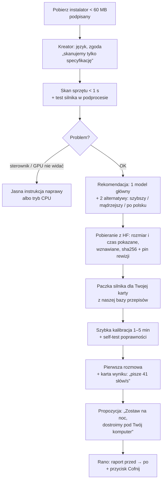
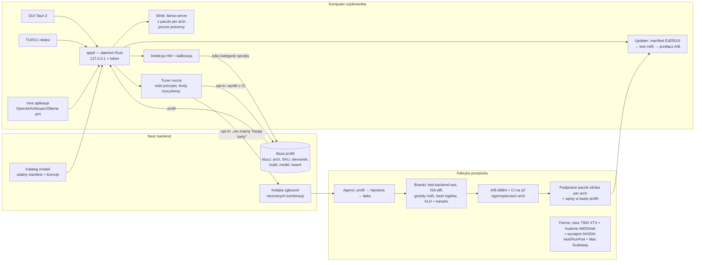
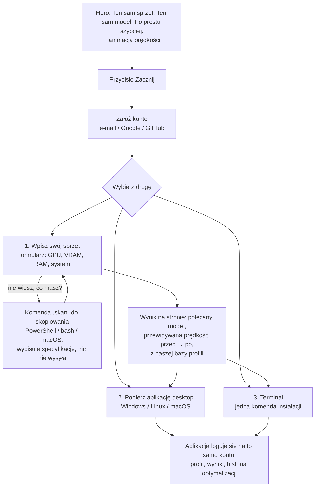

# Plan produktu: lokalne AI „plug and play”, które samo się przyspiesza

Stan: 2026-10-15. Plan zbudowany na 7 raportach w `research/` (≈4100 linii, ≈600 źródeł) i na naszych pomiarach z `qwen-opt/`.
Wszystko oznaczone `[SZACUNEK]` jest wnioskiem, nie pomiarem.

---

## 0. Werdykt w jednej minucie

1. **Da się, i luka na rynku jest realna.** Sprawdziliśmy 30+ produktów (LM Studio, Ollama, Jan, Msty, Lemonade AMD, Foundry Local, Strata, TensorFold…). Żaden nie robi naraz:
   - zmierzonego baseline'u na komputerze użytkownika;
   - optymalizacji poza flagami (kernele, scheduler, spekulacja);
   - weryfikacji „te same odpowiedzi” (md5 / KLD);
   - raportu „przed → po”;
   - obsługi AMD jako pełnoprawnej platformy.
2. **Ale trzeba poprawić jedno założenie.** Duży skok (np. Qwen 40 → 109 t/s) **nie** bierze się z „nocy na komputerze użytkownika”. Bierze się z:
   - **(a)** poprawnej konfiguracji: spekulacja MTP, backend, dopasowanie pamięci, pułapki sterownika. To ×1.5–2.2 i działa w minutach.
   - **(b)** **przepisów robionych w naszym labie** per (architektura GPU × rodzina modelu): kernele, fuzje, PM4. To kolejne +30–70% dla pary, którą przerobiliśmy.

   Noc u użytkownika dokłada typowo **0–15%**, więcej tylko przy MoE z offloadem do RAM i na nietypowym sprzęcie. Źródła: raport 02 §3, raport 07 §3.1.
3. **Dlatego produkt to dwie rzeczy:**
   - **aplikacja**, która dostarcza wynik natychmiast i uczciwie go mierzy;
   - **fabryka przepisów**: nasz lab z agentami, bramkami poprawności i bazą wyników, który zamienia nowe (GPU, model) w zweryfikowane przyspieszenie w dniach, nie tygodniach.

   „Zostaw na noc” zostaje, ale robi co innego (§4.3): dostraja *twoją* maszynę, a gdy twojej kombinacji nie znamy, zgłasza ją do fabryki (opt-in). Przepis przychodzi później jako podpisana aktualizacja. To jest wersja Twojego pomysłu „łączy się z providerem i jest optymalizowane”.
4. **Fosa (to, czego nie da się szybko skopiować):** baza zweryfikowanych profili per (GPU, sterownik, wersja silnika, model, kwant) plus tempo fabryki. Warstwa konfiguracyjna stanie się towarem w 6–12 miesięcy, bo LM Studio, Jan, TurboLLM i Lemonade już idą w tę stronę (raport 01 §3.1).
5. **Platformy: rozwijamy i testujemy na Linuksie, ale każda optymalizacja ma obowiązkowy krok „analiza platformy”** (§4.5). Decyzja z 2026-10-15.
   - Klienci siedzą głównie na Windowsie, więc ta analiza zawsze odpowiada na pytanie, co się zmienia na Windows i macOS: inne sterowniki, inny runtime, inne pułapki.
   - Nasz dowód jest z Linuxa. PM4 i część zysku LFM to ROCr, którego na Windows nie ma. Obietnica na Windows to L0 + L1 + przenośne łatki, dopóki nie zmierzymy więcej.
6. **Kolejność:** najpierw dowód (faza 0, 3–4 tygodnie; koszt to głównie zakup kart z §5.2), potem silnik + CLI/TUI, potem GUI i noc, potem płatna edycja i macOS. Nie zaczynamy od GUI.

---

## 1. Co ustalił research (najważniejsze fakty)

| Obszar | Fakt | Konsekwencja | Raport |
|---|---|---|---|
| Konkurencja | Skan sprzętu + „pasuje / nie pasuje” to już standard (LM Studio, Jan, Ollama, `--fit` w llama.cpp od 12.2025) | To bilet wstępu, nie wyróżnik | 01 §2 |
| Konkurencja | Najbliżej: Strata (`--calibrate` 15–30 min, 1 model), MTPLX (Mac, przed → po w UI, 1 gałka), TurboLLM / ggrun (tylko flagi), Lemonade Auto-Tune (AMD, nic nie wydane) | Okno czasowe ~6–12 mies. na warstwę konfiguracji | 01 §3.1 |
| Konkurencja | NVIDIA zamknęła ChatRTX (01.2026) i wnosi przyspieszenia do llama.cpp (do 1.9× na 5090) | Na NVIDIA nasz margines nad upstreamem będzie mniejszy niż na AMD | 01, 03 |
| Bóle użytkowników | „GPU wykryte, a liczy CPU”, „po aktualizacji wolniej”, „AMD nie działa” (165 issues `amd` w Ollamie), ukryte domyślne (ctx 2–4k) | Strażnik regresji + „jesteś na GPU” + brak cichych pułapek | 01 §2.6 |
| Autotuning | Wynik strojenia kerneli zależy od (arch, kształt, sterownik), nie od egzemplarza karty. Przemysł rozdaje wyniki (MIOpen PerfDb, TensorRT-RTX, TunableOp) | Stroimy raz w chmurze / labie, użytkownik dostaje dane | 02 §3.1 |
| Autotuning | Agenci piszący kernele: METR 1.81× średnio, ale uczciwy pomiar L1 = mediana 1.0001×; Sakana 3.13× → 1.49× po usunięciu reward hackingu | Agenci tylko w labie, z bramką poza ich zasięgiem | 02 §2.3 |
| Pomiar | Ta sama konfiguracja 12× w jeden dzień: +17…+27%; laptop na baterii 163 → 98.5 t/s | Protokół ABBA, test A/A, przedziały ufności, „brak werdyktu” | 02 §2.6 |
| Silnik | Upstream llama.cpp: 143 commity w 6 dni, 33 z naszych 69 plików zmienione; od teraz wydania semver (v0.7.0) | Twardy fork nie przeżyje → cienka nakładka na tagach semver | 03 §3.1 |
| Silnik | llama.cpp zakazuje automatycznych PR i opisów PR pisanych przez AI | Upstream tylko ręcznie, przez człowieka | 03 |
| Silnik | Nikt (poza llama.cpp) nie pokrywa NVIDIA + AMD + Intel + Apple na Win/Linux/mac. MLX opłaca się na Macu do ~14B | llama.cpp jako baza, MLX tylko na Macu w fazie 3 | 03 |
| Rozmiar | Vulkan build 31 MB; CUDA ~150 + 400 MB; ROCm per rodzina 183–654 MB; Ollama 1.5 GB | Instalator <60 MB, paczki GPU po detekcji | 03 §3.6 |
| Sprzęt | WMI `AdapterRAM` obcina VRAM do 4 GB; Strata myliła AVX2 i VRAM; NVIDIA na Windows po cichu wylewa VRAM do RAM (5–30× wolniej) | Detekcja z wielu źródeł + pomiar + budżet z marginesem | 04 §2.1 |
| Estymacja | Nasz wzór pamięci trafia ±0.1% (Qwen, LFM); prędkość potrzebuje modelu dwuczłonowego (pasmo + przerwy między kernelami) | Pokazujemy przedział, zaraz zastępujemy pomiarem | 04 §3.2 |
| Rynek HW | Steam: NVIDIA ~76%, karty 8–16 GB = 67%; Apple ~25% wśród użytkowników HF; RX 9070 XT najpopularniejszy Radeon | Wolumen = NVIDIA 8–16 GB; wyróżnik = AMD | 04 §2.4 |
| Lab | NVIDIA tanio na Vast (3060 $0.08/h, 3090 $0.23/h, 4090 $0.51/h, 5090 $0.73/h); Radeony konsumenckie prawie niedostępne z rootem; Arc nigdzie na godziny | NVIDIA wynajmujemy; AMD/Intel kupujemy; Apple: Scaleway | 05 §3.1 |
| Lab | W kontenerach (Vast/RunPod/Salad) brak liczników profilera i blokady zegarów; VM lub dedyk tak | Benchmarki w kontenerach, profilowanie w VM | 05 §2 |
| UX | Powyżej ~15–20 słów/s czytający nie czuje różnicy; czuje czas do pierwszego słowa, czas ukończenia, czas „myślenia” | Pokazujemy „odpowiedź 500 słów: 14 s → 6 s”, nie same t/s | 06 §2.1.2 |
| UX | Polski kosztuje ~2.3× więcej tokenów niż angielski (Qwen3: 2.69 vs 1.17 tok/słowo) | Przeliczniki PL/EN w UI; Bielik (tokenizer APT4) jako opcja PL | 06 §2.1.2 |
| Prawo | AI Act art. 50(2): oznaczanie tekstu AI (>200 tok.) maszynowo; brak okresu przejściowego dla nowych produktów | **Opinia prawna / KRiBSI przed launchem w UE** | 06 §2.3 |
| Prawo | Licencje: Qwen3.8-27B, Gemma 4, gpt-oss, Mistral Small 4, Bielik v3 = Apache 2.0. LFM: darmowy komercyjnie tylko <10 mln USD przychodu. Llama 4: brak praw dla firm z UE (multimodal) | Domyślny katalog tylko Apache/MIT; LFM jako opcja; Llama 4 wykluczona | 06 §2.4 |
| Dystrybucja | EV nie omija już SmartScreen; Azure Artifact Signing ~$9.99/mies., w UE tylko dla organizacji | **Potrzebna spółka** (sp. z o.o.) przed publiczną betą na Windows | 06 §3.2 |
| Dystrybucja | Mac App Store zabrania pobierania kodu; Homebrew odrzuca niepodpisane casks od 09.2026 | Profile optymalizacji = podpisane **dane**, nie kod | 06 §3.1 |
| Biznes | Nikt nie sprzedaje konsumentom „przyspieszenia”; ludzie płacą za UX (Msty $149/rok, Private LLM $4.99) | Popyt na płatny tuning trzeba **zmierzyć** przed budową płatności | 01, 06 |
| Nasze metody | 70 łatek: 22 pod model, 18 pod RDNA3, 12 wspólny kod CUDA/HIP (nigdy nieuruchomiony na NVIDIA), 10 hostowych (każdy backend) | Na innych GPU przenosi się mała część; reszta to nowa kampania per arch | 07 §2.1 |
| Nasze metody | Łatki Qwena same dały LFM +17% (169 → 198); ~11 h pracy pod LFM dało kolejne +49% (→ 295) | **Koszt przepisu dla nowego modelu na znanym GPU ≈ 1 dzień** — to metryka fabryki | 07 §2.3 |

---

## 2. Anatomia „przed → po” (uczciwie)

| Warstwa | Co robi | Gdzie liczona | Czas u użytkownika | Zysk (dowód / szacunek) |
|---|---|---|---|---|
| **L0 Naprawy** | wykrycie usypiania GPU (BACO: u nas 4.4 vs 92 t/s), wylewanie VRAM do RAM na NVIDIA/Windows, model na CPU zamiast GPU, obcięty kontekst | lokalnie | sekundy | od 0% do **×20**, gdy coś było zepsute |
| **L1 Konfiguracja** | backend (Vulkan / ROCm / CUDA), dopasowanie pamięci (`--fit`), spekulacja (MTP / DFlash / n-gram), typ KV (tylko za zgodą), `ubatch`, wątki, sampler bez wolnych ścieżek | dane z bazy + szybka kalibracja | 1–5 min | **×1.5–2.2** wobec naiwnej instalacji (Qwen na Vulkanie: 38.8 → 85.6 t/s samym włączeniem MTP) |
| **L2 Strojenie** | wybór spośród prekompilowanych wariantów kerneli, MoE offload, długość draftu na *twoich* tekstach | lokalnie, noc | godziny | **+0–15%**; więcej przy MoE z offloadem `[SZACUNEK]` |
| **L3 Przepis** | nowe kernele, fuzje, scheduler dla (arch × rodzina modelu), dostarczane jako podpisana paczka silnika | nasz lab (agenci + bramki) | 0 (przychodzi aktualizacją) | **+30–70%** dla pary, którą przerobiliśmy (Qwen na gfx1100: 85.6 → 109 t/s; LFM 198 → 294) |

**Zasady ekranu wyniku:**
- trzy słupki:
  - „typowa aplikacja” (zmierzone Ollama / LM Studio z domyślnymi ustawieniami, tym samym harnessem);
  - „nasz silnik od razu” (L0 + L1 + L3 z bazy);
  - „po nocy” (L2);
- przy każdym słupku podpis, z której warstwy pochodzi zysk;
- liczby w słowach/s i w czasie zadania, mediana i przedział z naprzemiennego A/B;
- odznaka „odpowiedzi identyczne bit w bit (12/12 testów)” albo „jakość potwierdzona KLD” dla zmian numeryki (tylko opt-in);
- jeśli różnica mieści się w szumie, napis „brak istotnej zmiany” zamiast naciąganego zysku.

**Uwaga o obietnicy jakości:** spekulacja w llama.cpp nie daje bajtowo tego samego tekstu co dekodowanie bez niej (u nas MTP i plain mają różne md5). Obietnica brzmi więc: „ten sam model, ta sama jakość; nasze przyspieszenia nie zmieniają odpowiedzi względem standardowego trybu”, a nie „identycznie jak bez spekulacji”.

---

## 3. Produkt

### 3.1 Dla kogo i co obiecujemy
- **Persona 1 „Gracz z dobrą kartą”:** RTX 3060–5090 albo RX 7800–9070, Windows, słyszał o lokalnym AI, nie zna llama.cpp.
- **Persona 2 „Entuzjasta”:** r/LocalLLaMA, Linux albo Windows, ma już Ollamę lub LM Studio, chce szybciej.
- **Persona 3 „Firma / integrator”** (później): ta sama konfiguracja na N maszynach, licencje modeli pod kontrolą.

**Hasło robocze:** „Twoje AI na Twoim komputerze. Dobrane, zmierzone i przyspieszone. Te same odpowiedzi.”

### 3.2 Przepływ dla laika (pierwsze uruchomienie, cel: rozmowa w < 10 min)

### 3.3 Ekrany (MVP)
1. **Start / Czat:** prosty czat oparty na **web UI z llama.cpp** (`tools/ui`: SvelteKit 2 + Svelte 5, licencja MIT; wolno go użyć i zmienić, trzeba tylko zachować informację o prawach autorskich ggml). Do tego wybór „mózgu” (Mały / Średni / Duży + Polski) i wskaźnik „liczy na GPU ✓”. Decyzja z 2026-10-15.
2. **Mój komputer:** GPU, VRAM, RAM, sterownik; ostrzeżenia (np. „karta usypia się — naprawiliśmy”).
3. **Wynik:** trzy słupki z §2, czas typowych zadań, szczegóły techniczne pod rozwinięciem.
4. **Optymalizacja nocna:**
   - postęp, szacowany czas, temperatura;
   - pauza, gdy używasz komputera;
   - tylko na zasilaczu;
   - historia wyników i Cofnij.
5. **Modele:** katalog z etykietami „Pasuje / Będzie wolno / Nie zmieści się”, licencja przy każdym modelu.
6. **Dla programistów:** adres lokalnego API (OpenAI / Anthropic / Ollama-compatible), token, przykłady.
7. **TUI/CLI:** te same funkcje w terminalu; wygląd na bazie REACTOR-a (`~/KERNEL/monitor`).

---

## 4. Architektura systemu

### 4.1 Silnik (decyzja: cienka nakładka na llama.cpp)
- **Baza:** tag semver llama.cpp (v0.7.0 → kolejne, ~10 dni). Rebase raz na wydanie, a bot raportuje, które łatki przestały się nakładać.
- **Łatki:** małe rodziny z predykatami (arch, arch modelu, kwant, KV). Każda z wyłącznikiem env i każda przechodzi bramkę w CI. Łatka, która nie przechodzi, zostaje wyłączona i nie blokuje wydania.
- **Budżet łatek:** łatka, która przez N wydań nie weszła do upstreamu i nigdzie nie daje ≥3%, jest usuwana (narzędzie `loo.py` już istnieje).
- **Strojone parametry w danych, nie w kodzie:** tabele per arch z Kernel Tunera (`kt-table-<arch>.inc`) zamieniamy na tabele ładowane z profilu, gdzie się da.
- **Upstream:** ogólne rzeczy (sampler 0031/0048/0066–0069, pętla hosta 0047, q8_1 0003/0015/0023, async wejścia 0029/0059) zgłaszamy ręcznie, opis pisze człowiek, z ujawnieniem użycia AI. To zmniejsza koszt rebase.
- **Później:** MLX na Macu (faza 3); osobny „turbo-silnik” dla 1–2 flagowych modeli tylko wtedy, gdy dane pokażą, że dominują (faza 4).

### 4.2 Detekcja sprzętu i dobór modelu
- **Detekcja w 3 etapach** (raport 04 §3.1):
  1. inwentarz < 300 ms bez admina: DXGI / NVML / ADLX / Level Zero / Vulkan / sysfs / Metal;
  2. test silnika w podprocesie (`ggml_backend_dev_get_props`, parowanie po PCI bus id);
  3. pomiar 3–10 s.

  Zakazane źródła: WMI `AdapterRAM` i parsowanie `nvidia-smi`.
- **Estymator:** nasz wzór pamięci (±0.1% na Qwen i LFM), weryfikowany przez `llama_params_fit` przed startem. Prędkość pokazujemy jako przedział i zastępujemy pomiarem.
- **Katalog** to zdalny, podpisany manifest aktualizowany co 4–8 tygodni. Licencja jest metadaną, a model niezgodny z polityką jest automatycznie blokowany.

  | Próg | Domyślny model |
  |---|---|
  | 4 GB / CPU | Qwen3.5-4B |
  | 8 GB | Qwen3.5-9B |
  | 12 GB | Gemma 4 12B |
  | 16 GB | Qwen3.8-27B Q3 albo gpt-oss-20b |
  | 24 GB | **Qwen3.8-27B Q4_K_XL**, czyli nasz flagowiec |
  | 32 GB | Qwen3.8-27B Q6/Q8 |
  | Mac 128 GB | gpt-oss-120b |

  - Polski: Bielik v3 jako opcja do 12 GB, po naszym pomiarze jakości PL.
  - LFM2.5: opcja „najszybszy”, nie domyślny (licencja z progiem).
- **Hybrydy (Qwen3.8, LFM, Nemotron-H) jako nasz atut:** mają 3–4× mniejszy KV, więc dają długi kontekst na 16–24 GB, a nasze łatki są pod nie.

### 4.3 Optymalizacja u użytkownika
**Szybka kalibracja (zawsze, 1–5 min):**
1. naprawy L0;
2. dopasowanie pamięci z testem pełnego kontekstu;
3. wybór backendu i paczki z bazy;
4. pomiar kosztu kroku spekulacji (`--spec-synth-len`, bez treści użytkownika);
5. self-test logitów 5–30 s;
6. baseline z testem A/A.

**Noc (opcjonalnie, za zgodą):**
- warunki: zasilacz, bezczynność (brak innych kontekstów GPU), limity temperatury i mocy;
- odporność:
  - checkpointy, wznawianie;
  - limit czasu kernela < 2 s (Windows TDR po 2 s, a 5 resetów w 60 s kończy się crashem);
  - czarna lista kandydatów;
- strojenie lokalnie:
  - wybór spośród 2–3 prekompilowanych wariantów kerneli z bazy;
  - MoE offload;
  - `ubatch`, wątki;
  - długość draftu na *twoich* tekstach (lokalnie, do chmury idą tylko liczby);
- każdy kandydat: bramka md5 lokalnie, potem ABBA z CI, a zysk uznany tylko przy |Δ| > 2σ z testu A/A;
- zmiany numeryki (np. KV q4) tylko jako osobny „Tryb maksymalny” z jasnym opisem jakości i KLD;
- **opt-in:** wyniki z CI trafiają do bazy profili. Nieznana karta lub model trafia do kolejki fabryki, a gotowy przepis przychodzi aktualizacją.

**Strażnik regresji:** po każdej aktualizacji silnika, sterownika lub modelu automatyczny re-pomiar. Jeśli jest wolniej, wracamy do poprzedniej paczki.

**Nigdy na komputerze użytkownika:** agenci LLM, kompilacja kodu, zmiany numeryki bez zgody.

### 4.4 Fabryka przepisów (lab)
- **Proces = nasz playbook** (raport 07 §2.2, 10 kroków):
  1. sufit pasma;
  2. profil per token;
  3. koszt granicy kernela;
  4. ablacja;
  5. hipoteza z budżetem µs;
  6. łatka z wyłącznikiem;
  7. testy op;
  8. bramka bit / KLD;
  9. przeplatane A/B;
  10. wpis w NOTES, także dla wyników negatywnych.
- **Narzędzia, które już mamy:** `greedy.sh`, `spec_sweep`, `samp_ab.py`, `kld_gate` + kanarki, `loo.py`, Kernel Tuner harness, emulator ISA GDN, `isadiff.py`, REACTOR, `pm4_soak.py`, `det_probe.py`.
- **Czego brakuje do „przemysłu”** (raport 07 §3.2):

  | Komponent | Brak |
  |---|---|
  | farma | scheduler wielu maszyn |
  | serwis bramek | API + magazyn referencji |
  | baza benchmarków | jedna baza zamiast jsonl, pola termiczne |
  | adaptery profilera | NVIDIA nsys / ncu, Apple |
  | pakowanie przepisów | manifesty, predykaty, bot rebase |
  | orkiestracja agentów | ledger hipotez |
- **Antyoszustwo dla agentów:** referencja i pomiar poza powierzchnią, którą agent może modyfikować; fingerprint wyjść; checkpoint „czy zmiana w ogóle się wykonała”. To lekcje z Sakana, Kevin, METR i GPU MODE.
- **Metryki fabryki:**
  - czas od premiery modelu do przepisu na top-3 arch (cel ≤ 7 dni);
  - koszt przepisu ($ GPU + $ tokenów);
  - odsetek łatek przechodzących rebase bez ręcznej pracy.

### 4.5 Analiza platformy (obowiązkowy krok każdej optymalizacji)
Każda łatka, profil i ustawienie dostaje w fabryce rubrykę „gdzie działa i co się zmienia”. Bez niej nie trafia do produktu.

| Temat | Linux | Windows | macOS |
|---|---|---|---|
| Sterownik / runtime AMD | amdgpu + ROCm (ROCr/KFD); **PM4 możliwe** | HIP SDK na innym runtime niż ROCr `[SZACUNEK: do potwierdzenia]` → **PM4 i łatki zależne od ROCr nie działają**; Vulkan często najszybszy w decode | brak |
| Sterownik NVIDIA | CUDA; tryb persistence | CUDA na WDDM; **„Sysmem Fallback”**: po przekroczeniu VRAM po cichu do RAM, 5–30× wolniej → budżet z marginesem i alarm | brak |
| Limity czasu GPU | brak | **TDR: kernel > 2 s = reset sterownika**, 5 resetów w 60 s = crash → limit czasu kandydatów w nocy | watchdog Metal |
| Usypianie GPU | **BACO / runtime PM** (u nas 4.4 vs 92 t/s) → keepawake | plany zasilania, „najlepsza wydajność” | App Nap, Low Power Mode |
| Pamięć | VRAM + GTT; `mmap` stron | VRAM dedykowana + „shared”; Defender skanuje wielogigabajtowe pliki modeli przy wczytaniu | **pamięć zunifikowana**, limit `recommendedMaxWorkingSetSize` |
| Uprawnienia | grupa `render` / `video` dla `/dev/kfd` | bez admina; podpis każdego .exe/.dll | notaryzacja |
| Szum pomiaru | mały (serwer) | przeglądarka, gry, nakładki (Discord, Steam) używają GPU → wymagana bezczynność, ABBA | throttling termiczny laptopów |
| Backend domyślny | ROCm / CUDA / Vulkan wg pomiaru | Vulkan (AMD, Intel), CUDA (NVIDIA) wg pomiaru | Metal, później MLX |
| Co się przenosi z naszych 70 łatek | wszystko | łatki hostowe, sampler, spekulacja, kernele HIP/CUDA (bez ROCr/PM4), Vulkan | łatki hostowe, sampler, spekulacja |

Wynik analizy zapisujemy w manifeście łatki jako predykat, np. `os: [linux]`, `runtime: rocr`. Daemon włącza łatkę tylko tam, gdzie predykat jest spełniony.

---

## 5. Platformy, sprzęt, lab

### 5.1 Kolejność platform (pogodzenie raportów 01 i 04)
- **Rozwój i testy: Linux** (nasz serwer + ława testowa). Decyzja z 2026-10-15: nie robimy teraz testów na Windowsie.
- **Projekt od początku na Win / Linux / macOS**: detekcja, paczki i analiza platformy (§4.5) dla każdej łatki. Windows wchodzi jako platforma wydawnicza, gdy przepisy przejdą bramki na Windowsie (CI na wynajmowanej maszynie z Windowsem albo ława z dual bootem, później).
- **Wolumen** to NVIDIA (76% Steam), **wyróżnik i dowód** to AMD. Robimy oba: dla NVIDIA na start wystarczy L0 + L1, a dla AMD mamy L3.
- **Faza 3:** macOS (Metal, potem MLX), Intel Arc (Vulkan), Strix Halo.
- **Później:** telefon. Prompt MiniCPM pokazał ×3 prefill i ×2 decode, więc playbook przenosi się na ARM.

### 5.2 Lab (raport 05)
- **NVIDIA: kupujemy najpopularniejsze karty** (decyzja z 2026-10-15: budżet na karty jest), a rzadkie i drogie (3090, 4090, 5090) wynajmujemy na Vast, bo kupno 3090 to ~€1.2k, a godzina wynajmu ~$0.23. A/B tylko w obrębie jednego hosta, bo karty tego samego modelu różnią się średnio o 8%.
- **Lista zakupów (priorytet):**

  | # | Karta | Arch | VRAM | Dlaczego | Cena (raport 05, do sprawdzenia przy zakupie) |
  |---|---|---|---|---|---|
  | 1 | RTX 5060 Ti 16GB | Blackwell sm_120 | 16 | #3 w Steam, najpopularniejsze 16 GB | ~$474–680 nowa |
  | 2 | RTX 3060 12GB | Ampere sm_86 | 12 | #5 w Steam, najtańsze 12 GB | ~€257 używana |
  | 3 | RX 9070 XT | RDNA4 gfx1201 | 16 | najpopularniejszy Radeon; RDNA4 wymaga nowych kerneli WMMA | ~€694 używana |
  | 4 | RTX 5070 | Blackwell sm_120 | 12 | **#1 w Steam** (6.15%) | do sprawdzenia |
  | 5 | Arc B580 | Xe2 | 12 | jedyny realny Intel, nigdzie do wynajęcia | ~€270 |
  | — | **ława testowa** (osobny PC: zasilacz 850 W+, PCIe 4.0 x16) | | | serwer z 7900 XTX zostaje na produkcję i AMD; nowe karty w osobnej maszynie | ~€800–1,200 |
- **AMD:** nasz 7900 XTX (RDNA3), do tego **zakup RX 9070 XT** (RDNA4, ~€694) i wynajem Hostkey R9700 (€0.47/h, root) na kampanie. RDNA2 (6700 XT) w becie.
- **Intel:** zakup Arc B580 (~€270), bo nie da się go nigdzie wynająć na godziny.
- **Apple:** Scaleway Mac mini M4 (€0.22/h, minimum 24 h), od bety zakup.
- **MVP (12 kart):** RTX 3060 12GB, 3090, 4060 Ti 16GB, 4070, 4090, 5060 Ti 16GB, 5070, 5090, RX 7900 XTX, RX 9070 XT, Arc B580, Mac mini M4.
- **Od bety:** sieć opt-in użytkowników. Uruchamia tylko podpisane buildy, nigdy cudzy kod, a profil staje się domyślny dla SKU po ≥3 niezależnych potwierdzeniach z tym samym md5. To główne źródło dla laptopów i rzadkich kart.

---

## 6. Stack technologiczny

| Warstwa | Wybór | Alternatywa | Dlaczego |
|---|---|---|---|
| Silnik | llama.cpp, cienka nakładka na tagach semver; paczki per arch; parametry w danych | MLX (Mac, faza 3); turbo-silnik per model (faza 4) | pokrycie „dowolny model i GPU” bez etatu na rebase |
| Daemon | **Rust**; silnik jako osobny proces potomny | Go (jak Ollama) | jeden język dla daemona, TUI i backendu GUI; bezpieczeństwo parserów GGUF/HTTP; izolacja crashy silnika |
| GUI | **Tauri 2** + **web UI z llama.cpp** (SvelteKit 2 / Svelte 5, MIT) jako baza czatu, rozbudowany o nasze ekrany | Electron | instalator 3–15 MB, podpisane aktualizacje wbudowane; gotowy, dojrzały czat zamiast pisania od zera; na Linuksie GUI jako beta (WebKitGTK) |
| TUI/CLI | **ratatui** (styl REACTOR) | Bubble Tea | wspólny kod z daemonem |
| API | OpenAI (chat + Responses) + Anthropic Messages + emulacja Ollama `/api`; tylko 127.0.0.1, token, walidacja Host/Origin, własny port | — | standard rynku; lekcje z CVE Ollamy |
| Paczki | instalator: CPU + Vulkan (Win/Linux) albo Metal; CUDA / HIP-per-rodzina dociągane po detekcji, podpisane, content-addressed | wszystko w instalatorze (1.5 GB jak Ollama) | szybki start; wersja do MS Store ma wszystko w środku |
| Aktualizacje | updater Tauri / Velopack (aplikacja) + manifest Ed25519 (silnik) ze slotami A/B i automatycznym rollbackiem po teście md5 i prędkości | electron-updater | weryfikacja poprawności jako część aktualizacji |
| Backend chmurowy | mały: katalog + baza profili + kolejka zgłoszeń (Postgres + object storage, hosting w UE) | — | RODO, tani start |
| CI | build na GitHub-hosted (Win/Ubuntu/mac); testy GPU na self-hosted (nasz XTX + wynajem + Mac) | — | GitHub nie ma runnerów AMD GPU |

---

## 7. Prawo, dystrybucja, prywatność (raport 06 §3.2)

- **Spółka z o.o.** (S24, ~275 zł, 1–3 dni). Bez niej nie dostaniemy podpisu Azure Artifact Signing w UE ani konta Apple dla organizacji. Potem D-U-N-S, Apple ($99/rok), Artifact Signing (~$10/mies.), konto Microsoft Store (za darmo, omija SmartScreen).
- **Podpisany każdy plik .exe/.dll.** Profile to podpisane dane (JSON), nie kod.
- **AI Act:**
  - art. 50(1): informacja „rozmawiasz z AI” w UI;
  - **art. 50(2): oznaczanie wygenerowanego tekstu.** To najważniejsze otwarte pytanie prawne, do kancelarii lub KRiBSI, 1–3 miesiące. Robimy to równolegle z fazą 1.
- **RODO / PKE:** telemetria wyłączona domyślnie, podgląd wysyłanego JSON, odrzucanie IP przy przyjmowaniu danych. Wysyłamy tylko kategorie sprzętu, nigdy numerów seryjnych, UUID ani nazwy hosta.
- **CRA:** polityka zgłaszania podatności, SBOM per wydanie. **PLD:** OC produktu (dotyczy oprogramowania od 9.12.2026).
- **Licencje:**
  - NOTICE dla llama.cpp (MIT), ROCm, CUDA (tylko pliki redystrybuowalne);
  - LICENSE każdego modelu;
  - Llama 4 wykluczona;
  - modeli uncensored nie ma w katalogu ani w marketingu; import własnego GGUF jako opcja „zaawansowane”.
- **Koszt roku 1:** ~5.8 tys. zł opłat twardych; ~30–55 tys. zł z kancelarią i ubezpieczeniem `[SZACUNEK]`.

---

## 8. Biznes (hipotezy do sprawdzenia, nie decyzje)

| Edycja | Zawartość | Cena (hipoteza) |
|---|---|---|
| **Free** | skan, rekomendacja, pobieranie, kalibracja L0+L1, gotowe profile L3 z bazy, czat, lokalne API | 0 |
| **Turbo** | noc L2, re-tuning po aktualizacjach, „Tryb maksymalny” (KLD), priorytet w kolejce fabryki dla Twojej kombinacji, nowe modele w dniu premiery | 149 zł/rok lub 299 zł dożywotnio (early-bird); ~39 €/rok |
| **Business** | licencja komercyjna, profile flotowe, filtr licencji modeli | ~8 €/stanowisko/mies. |
| **OEM** | profile per model komputera, preinstalacja (x-kom, Komputronik, integratorzy) | 1–3 € za urządzenie |
| **Tuning Lab** | strojenie konkretnego modelu × sprzętu klienta z raportem bitowym | od 5 k€ |

- **Ryzyko kanibalizacji:** jeśli darmowe profile dają prawie wszystko, Turbo jest zbędne. Free dostaje profile uśrednione per SKU, Turbo profil *twojej* maszyny i kolejkę fabryki.
- **Model kodu (do decyzji):**
  - łatki silnika otwarte (MIT, upstream);
  - orkiestrator strojenia, baza profili i harness bramek zamknięte;
  - albo całość na FSL-1.1 (otwarta po 2 latach, jak TurboLLM).
- **Wejście na rynek:**
  - publiczny benchmark „przed → po” na r/LocalLLaMA i Hacker News;
  - wpisy na LocalMaxxing i LocalScore;
  - recenzenci na YouTube;
  - rozmowa z AMD (Lemonade Auto-Tune WG, AI Bundle w Adrenalinie) jako kanał dystrybucji, nie konkurent;
  - Polska jako rynek testowy (język, Bielik).
- **Popyt zmierzyć przed budową płatności:** strona z wynikiem przed → po i listą oczekujących z ceną (fake-door), w fazie 1.

### 8.1 Landing page (pomysł z 2026-10-16; budujemy po fazie 0, gdy będą zmierzone liczby)
- **Hero:** „**Same hardware. Same model. Just faster.**” / „**Ten sam sprzęt. Ten sam model. Po prostu szybciej.**”
- **Obok animacja (motion):** licznik prędkości lub dwa strumienie tekstu obok siebie („typowa aplikacja” vs „nasza”) generujące tę samą odpowiedź w różnym tempie. Liczby tylko z naszych pomiarów, z podpisem: karta, model, metoda.
- **Pod hero:**
  - tabela kart (z fazy 0: XTX, 3090, 5060 Ti, 3060…): przed → po;
  - „jak to działa” w 3 krokach (skan → dobór → przyspieszenie);
  - odznaka „odpowiedzi bit w bit” z linkiem do metodologii;
  - lista oczekujących z testem ceny (fake-door).
- **Produkcyjnie i zgodnie z prawem:**
  - regulamin, polityka prywatności (RODO, cookies tylko za zgodą);
  - dane firmy (spółka z §7);
  - informacja „AI” (AI Act art. 50);
  - każde „×2” udokumentowane metodologią i surowymi wynikami (dyrektywa UCPD);
  - dostępność WCAG 2.2 AA;
  - hosting w UE;
  - formularz zapisów z podwójnym opt-in.
- Faza: szkic w fazie 1 (lista oczekujących), pełna strona przy publicznej becie (faza 2).

#### 8.1.1 Ścieżka użytkownika na stronie (pomysł z 2026-10-16)

- **Konto na początku:**
  - zapisuje sprzęt, wyniki „przed → po”, historię optymalizacji i edycję (Free / Turbo);
  - łączy stronę, aplikację desktop i terminal;
  - pozwala odesłać przepis z fabryki, gdy kombinacja nie była znana (§4.3).
  - Ryzyko: obowiązkowe konto przed pobraniem obniża liczbę instalacji. Do sprawdzenia testem A/B; alternatywa to pobieranie bez konta i logowanie przy pierwszej optymalizacji.
- **Droga 1, formularz sprzętu:**
  - pola z podpowiedziami (lista popularnych GPU z bazy);
  - wynik od razu na stronie, z naszego estymatora (§4.2) i bazy profili;
  - przy nieznanych kombinacjach uczciwy przedział zamiast liczby.
- **Komenda „skan” dla tych, co nie wiedzą, co mają:**
  - jedna linia do skopiowania (Windows PowerShell, Linux bash, macOS);
  - działa bez admina;
  - **wypisuje tylko** GPU, VRAM, RAM, CPU, system i sterownik w czytelnej formie, plus kod do wklejenia w formularz;
  - nic nie wysyła sama; kod źródłowy pod linkiem, żeby każdy mógł sprawdzić, co robi.
- **Droga 2, aplikacja desktop:** podpisany instalator dla wykrytego systemu (Windows / Linux / macOS); przy pierwszym uruchomieniu logowanie do konta i pełny skan (§3.2).
- **Droga 3, terminal:**
  - jedna komenda instalacji: `winget` / `brew` / skrypt `curl … | sh`, z sumą kontrolną i podpisem;
  - potem TUI/CLI z tym samym kontem.
- **Prawo przy koncie:**
  - RODO: minimalne dane, zgoda na marketing osobno, usunięcie konta jednym przyciskiem;
  - logowanie przez Google / GitHub zgodne z ich zasadami;
  - regulamin i polityka prywatności akceptowane przy rejestracji.

---

## 9. Roadmapa z kryteriami wyjścia

Czasy to szacunki dla nas + agentów. Każda faza kończy się dopiero po spełnieniu kryteriów.

### Faza 0: Dowód (3–4 tygodnie; koszt: karty z listy §5.2 + ewentualnie ~$10–20 wynajmu)
| # | Eksperyment | Pytanie | Kryterium |
|---|---|---|---|
| E1 | Ollama + LM Studio z domyślnymi ustawieniami vs nasz build, ten sam harness, ten sam GGUF, nasz 7900 XTX | Jaki jest prawdziwy „przed”? | Zmierzone liczby dla Qwen i LFM |
| E2 | Tylko L1 (flagi + spekulacja, czysty upstream v0.7.0) vs pełny stack, na 3–5 modelach (Qwen3.8, Gemma 4, gpt-oss-20b, Bielik, LFM) | Ile daje automat bez kerneli? | Tabela zysku per warstwa |
| E3 | **Analiza platformy na papierze**: dla każdej z 70 łatek rubryka z §4.5 (Linux / Windows / macOS) + build Windows w CI (kompilacja, bez uruchamiania) | Co z naszego zysku może działać na Windows? | Manifest łatek z predykatami OS/runtime |
| E4 | Kupione NVIDIA (5060 Ti 16GB, 3060 12GB) na ławie: L1 + nasze ogólne łatki na Qwen3.8 i gpt-oss | Jaki jest zysk na NVIDIA? Czy nasz wspólny kod CUDA działa poprawnie (nigdy nie był uruchomiony)? | md5 OK + tabela zysku |
| E5 | Kampania L3 na nowym modelu (np. Gemma 4 12B lub gpt-oss-20b) na 7900 XTX, z mierzonym czasem i kosztem | Ile kosztuje przepis? | Godziny agentów i GPU, zysk w % |
| E6 | Rebase 70 łatek na v0.7.0 + `loo.py run` + `kld_canary.sh` | Ile łatek realnie się opłaca? Czy bramka KLD łapie szkody? | Lista łatek do zachowania / usunięcia |
| E7 | Prototyp detekcji + estymatora (Rust, CLI) na serwerze i ławie testowej | Czy detekcja jest wiarygodna na AMD i NVIDIA? | Poprawny raport na obu maszynach |

**Wyjście z fazy 0:** decyzja „go / zmiana zakresu” na podstawie E1–E5, opisana w `product/F0-WYNIKI.md`.

### Faza 1: Silnik + CLI/TUI, alfa (6–8 tygodni)
- daemon Rust, detekcja, katalog (5 modeli Apache), pobieranie z weryfikacją;
- paczki silnika: Vulkan, CUDA, ROCm gfx110X;
- szybka kalibracja, karta wyniku w TUI, lokalne API;
- baza profili v0 i fabryka v0: CI z bramkami na XTX + wynajmowane NVIDIA;
- alfa dla ~20–50 osób z r/LocalLLaMA i znajomych;
- równolegle: założenie spółki, opinia o art. 50(2), strona z listą oczekujących (test cen).

**Wyjście:** na ≥8 kartach z listy MVP wynik ≥1.3× wobec Ollamy z domyślnymi ustawieniami, przy zerowej liczbie błędów md5; czas do pierwszej rozmowy < 10 min.

### Faza 2: GUI + noc, beta (8–12 tygodni)
- Tauri GUI (PL/EN), kreator, ekran wyniku, optymalizacja nocna z checkpointami;
- strażnik regresji, aktualizacje A/B z rollbackiem;
- sieć opt-in (pilot), kolejka zgłoszeń do fabryki;
- podpisany instalator Windows (Artifact Signing) + MS Store; Linux AppImage/deb;
- 22 karty w labie, RDNA4 i Arc kupione.

**Wyjście:** publiczna beta; ≥500 instalacji; crash rate nocy < 1%; pierwsze profile od społeczności.

### Faza 3: Launch + Turbo + macOS (od ~6.–9. miesiąca)
- płatna edycja (Paddle jako Merchant of Record), macOS (Metal, potem MLX), Intel Arc, Strix Halo;
- katalog ~10 modeli/mies.; przepis dla nowego modelu ≤ 7 dni na top-3 arch;
- rozmowy OEM / AMD.

### Faza 4: Rozszerzenia
Turbo-silnik dla flagowych modeli (wzór hipfire / Lucebox), telefon, edycja Business.

---

## 10. Budżet (rząd wielkości)

| Pozycja | Faza 0 | Faza 1 | Faza 2 | Faza 3 |
|---|---|---|---|---|
| GPU w chmurze | ~$50–150 łącznie | ~$500–600/mies. | ~$1.2–1.5k/mies. | ~$2.5–3.5k/mies. |
| Sprzęt (jednorazowo) | RX 9070 XT ~€700 (opcjonalnie już teraz) | Arc B580 ~€270 | RX 7800 XT, 6700 XT, RTX 3060, Mac mini: ~€1.5–2.5k | — |
| Prawo i dystrybucja | 0 | spółka + opinia AI Act: ~6–20 tys. zł | podpisy, Apple, regulaminy: ~10–30 tys. zł | OC, znak towarowy |
| Tokeny agentów (LLM) | główny koszt fabryki; prawdopodobnie > koszt GPU `[SZACUNEK]` | | | |

---

## 11. Największe ryzyka

| Ryzyko | Prawdopodobieństwo / wpływ | Odpowiedź |
|---|---|---|
| Zysk nie przenosi się poza 7900 XTX / Linux | średnie / wysoki | Faza 0 (E3, E4) **przed** budową aplikacji; obietnica „do X%”, mediana |
| LM Studio, Ollama, Jan lub NVIDIA wbudują auto-tuning konfiguracji | wysokie / wysoki | Fosa = L3 + baza profili + tempo fabryki + AMD-first; L1 dajemy za darmo |
| Upstream ucieka (rebase) | wysokie / średni | Nakładka na semver, budżet łatek, bot rebase, upstream ogólnych łatek |
| Fałszywe „po” (szum) | średnie / wysoki (reputacja) | ABBA, A/A, CI, „brak istotnej zmiany” |
| Crash podczas nocy (TDR, przegrzanie laptopa) | średnie / wysoki | Limity, checkpointy, czarna lista, tylko zasilacz |
| AI Act art. 50(2) koliduje z „bit w bit” | średnie / wysoki | Opinia prawna w fazie 1; znak wodny identyczny w obu wariantach A/B |
| Popyt na płatną edycję się nie potwierdzi | średnie / średni | Fake-door w fazie 1; B2B / OEM jako drugi filar |
| AV / SmartScreen przy starcie | wysokie / średni | Podpis każdego pliku, MS Store, zgłoszenia do Defendera przed wydaniem |
| Zależność od HF (przejęcie przez NVIDIA) | niskie–średnie / wysoki | Pin rewizji, mirror dla modeli Apache |

---

## 12. Decyzje, które musisz podjąć

1. ~~Kształt produktu~~ **Zdecydowane:** własny czat oparty na web UI z llama.cpp (MIT) + optymalizator + lokalne API.
2. ~~Kod~~ **Zdecydowane:** open core (łatki silnika otwarte, baza profili i orkiestrator strojenia zamknięte).
3. ~~Windows~~ **Zdecydowane:** testy teraz tylko na Linuksie; analiza platformy (§4.5) obowiązkowa dla każdej optymalizacji.
4. **Faza 0 teraz?** Wymaga użycia naszego GPU (E1, E2, E5, E6), zakupu kart z §5.2 i ławy testowej (E4, E7).
5. **Zakupy:** które karty z listy §5.2 i kiedy; ława testowa jako osobny PC.
6. **Spółka:** zakładamy w fazie 1 (potrzebna do podpisu na Windows i Apple), czy później?
7. **Nazwa** (propozycje z raportu 06: Podkręt, NightShift / Nocna Zmiana, Turbina, Rozpęd, Tuned), do sprawdzenia w EUIPO i domenach.

---

## 13. Raporty źródłowe

| # | Plik | Temat |
|---|---|---|
| 01 | [`research/01-konkurencja.md`](research/01-konkurencja.md) | 30+ aplikacji, bóle użytkowników, luka, zagrożenia |
| 02 | [`research/02-autotuning-i-agenci-kerneli.md`](research/02-autotuning-i-agenci-kerneli.md) | warstwy optymalizacji, agenci kerneli, bramki, metodologia pomiaru |
| 03 | [`research/03-silniki-i-stack.md`](research/03-silniki-i-stack.md) | silniki (Strata, TensorFold, hipfire, MLX…), strategia forka, Rust / Tauri / ratatui, paczki |
| 04 | [`research/04-wykrywanie-sprzetu-i-dobor-modeli.md`](research/04-wykrywanie-sprzetu-i-dobor-modeli.md) | detekcja per OS, wzory pamięci i prędkości, katalog per próg VRAM, udziały rynku |
| 05 | [`research/05-chmura-gpu-do-testow.md`](research/05-chmura-gpu-do-testow.md) | Vast, RunPod, Salad, Hostkey, Scaleway; ceny; lab; budżet |
| 06 | [`research/06-produkt-ux-prawo-biznes.md`](research/06-produkt-ux-prawo-biznes.md) | UX, uczciwy pomiar, AI Act, RODO, podpisy, licencje modeli, ceny, GTM, rejestr ryzyk |
| 07 | [`research/07-nasze-metody-uogolnienie.md`](research/07-nasze-metody-uogolnienie.md) | klasyfikacja 70 łatek, playbook, macierz uogólnienia, brakujące narzędzia |
