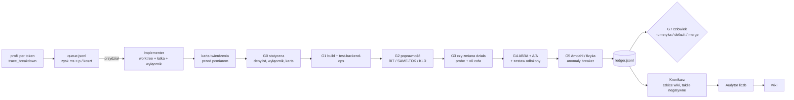

# 15f — Agentowa nauka: czego nauczyć naszą fabrykę (agenci + bramki) od systemów automatycznej nauki

Data: 2026-10-16. Bez lokalnego GPU i bez wydatków w chmurze. Materiał surowy:
- kod `SakanaAI/AI-Scientist-v3` @ `2b8aa39` (2026-10-14, jedyny commit, ~86k linii); trzy podagenty-scouty przeczytały go z cytatami `plik:linia`, a kluczowe cytaty sprawdziłem ręcznie;
- PDF arXiv 2610.18933 v1 (tabele, dodatki, prompty);
- repo `gpu-mode/kernelguard` @ `6797d26`;
- `turbo-tan/tqllm` @ `23af3c9`;
- abstrakty KernelGuard (ICML 2026 AIWILD) i „Winner's Curse” (arXiv 2610.09239);
- sekcje AlphaEvolve (arXiv 2506.13131).

Do tego pięć eksperymentów offline na CPU na naszych danych (§4). `[INFERENCE]` oznacza mój wniosek, `[NIEZWERYFIKOWANE]` twierdzenie, którego nie dało się sprawdzić, a `[SZACUNEK]` wycenę.

## 1. TL;DR

- **Sakana v3 nie jest „magicznym naukowcem”, tylko dyscypliną artefaktów.** Wartość siedzi w kodzie, nie w promptach.
  - Ewaluację uruchamia harness, nie agent.
  - Ewaluator jest przypięty hashami i zamontowany `:ro`.
  - Finalna ocena działa raz: `invocation.json` tworzony z O_EXCL, kandydat i ewaluator w osobnych kontenerach `--network none`, a łączy je broker.
  - Agent ablacji dostaje tylko diff, zadanie i ewaluator, ze świeżą pamięcią `"- none"`. Nie widzi rozumowania agenta, który wymyślił zmianę.

  Wszystko, co „naukowe”, rozstrzyga LLM-sędzia albo prompt: rubryki semantyczne, „ablacja zmienia jedną rzecz”, audyt liczb w paperze.
- **Sakana nie ma żadnej statystyki istotności.** Kod liczy tylko `{n, mean, std populacyjne, min, max}` (`paper_data_ablation.py:96-136`). Promocja kandydata to „ściśle większy wynik” bez marginesu szumu (`campaign_loop.py:584-605`). To dokładnie mechanizm „klątwy zwycięzcy”, który arXiv 2610.09239 mierzy na 13–20 pkt przy 16 elementach zbioru selekcji.

  **Nasze ABBA + sparowany CI w `loo.py` jest pod tym względem lepsze niż Sakana. Nie kopiować ich promocji.**
- **Najcenniejsza lekcja z papieru to porażka.** W 2 z 3 przebiegów Pi agent zmienił protokół ewaluacji (majority vote k-sample zamiast pass@1). Ani ewaluator, ani bramki rubryk tego nie złapały. Wykrył to dopiero ręczny audyt (arXiv 2610.18933 §6.3).

  Odpowiednik u nas: agent „przyspiesza” zmianą flag serwera, promptów albo `max_tokens` w `spec_sweep`. Obrona musi więc być strukturalna: harness poza zasięgiem implementera i diff-denylist, a nie rubryka.
- **KernelGuard (GPU MODE) daje wzorzec, który najlepiej pasuje do naszych lekcji.**
  - Deterministyczne reguły z dowodem w postaci fixture'a historycznego hacka (`RulePolicy.mapped_positive_fixtures`).
  - Do tego „physics floor” z roofline'u (`kernelguard.py:8085-8330`).
  - Znaleziska drogiego sędziego LLM są „destylowane” do tanich reguł.
  - Wynik: odsetek oszukanych zgłoszeń spadł z 3.45% (4889/141800) do 0.37% (152/40998) w 32 dni.

  Nasze 17 trybów awarii z raportu 07 to gotowy zestaw takich fixture'ów.
- **Pięć eksperymentów offline na naszych danych (koszt $0):**

  | eksperyment | wynik |
  |---|---|
  | E-A: dowody w commitach | tylko 25/70 commitów ma w treści „przed → po + powtórzenia/przeplot + marker poprawności”; **0/70** podaje niepewność (CI/σ); 25/70 nie ma żadnej liczby; 5 to UNMEASURED |
  | E-B: test A/A | w jednej sesji powtórka ms/krok różni się o **0.09%** (mediana z 15 par, Qwen ROCm); ten sam label „base” wskazuje na nadpisywany katalog `~/llama-opt` i dryfuje 29.12–29.81 ms między sesjami, więc label nie jest tożsamością binarki |
  | E-C: klątwa zwycięzcy | wybór konfiguracji spekulacji na 5 promptach, sprawdzany na 6. (odłożonym), zmienia znak przewagi nad drugim miejscem w 2–3 z 5–6 przypadków |
  | E-D: backtest reguły anomalii | jedyny prawdziwy incydent (5.6 t/s, 2026-10-10 22:48) złapany; 5/182 fałszywych alarmów, wszystkie przez wolny tekst labeli (`lfm3_inst qwen`) |
  | E-E: zbiór draft-vocab vs zbiór pomiarowy | brak dosłownego przecieku, ale ten sam temat („lighthouse keeper” vs „latarnik”) |
- **Fabryka v1 (propozycja, ~8–10 osobodni agentów, $0 na start):**
  - Role: Planista (rodzic), Implementer, **Weryfikator** (deterministyczny `factory verify` + LLM tylko do projektu ablacji z samego diffu), Audytor liczb, Kronikarz, Człowiek jako co-scientist.
  - Artefakty: `queue.jsonl`, karta twierdzenia rejestrowana **przed** pomiarem, `ledger.jsonl` (append-only, łańcuch hashy), `rules/` z fixture'ami.
  - Bramki w kaskadzie od najtańszej (wzór AlphaEvolve): G0 statyczna → G1 build/op → G2 poprawność → G3 „czy zmiana się wykonała” → G4 ABBA + A/A + odłożone prompty → G5 Amdahl/fizyka → G6 platforma → G7 zgoda człowieka.
- **Ranking:**
  1. ledger + karta twierdzenia;
  2. reguły z fixture'ami;
  3. `factory verify` jako izolowany weryfikator;
  4. zapieczętowany zestaw odłożonych promptów;
  5. audyt liczb w raportach i wiki;
  6. automatyczne szkice negatywnych wyników;
  7. wykresy z ledgera.

  AutoIllustrate i pula wielu równoległych implementerów na jedno GPU: **nie teraz**.
- **„Agenci zastępują samych siebie” (tqLLM): `[NIEZWERYFIKOWANE]`.**
  - Publiczne repo ma 80 commitów 3 autorów i żadnych śladów pętli Alpha/Omega.
  - Kolejka `docs/EXECUTION_QUEUE.md` jest cytowana w kodzie (`tests/golden_check.py:8`), ale nie istnieje w repo.
  - Agora jest prywatna.

  Jedyna rzecz, którą warto przejąć z tqLLM, jest sprawdzalna: **bramka „near-tie”**. Pierwszy rozjazd greedy jest akceptowany tylko wtedy, gdy wybrany token jest drugim tokenem FP32 przy marginesie ≤ 0.1 logita (`tests/golden_check.py:1-25`). To jest kandydat na brakującą bramkę „fork vs upstream” zamiast samego md5.

## 2. Audyt twierdzeń

Kolumny: twierdzenie, warunki (sprzęt / workload / baza / jakość), czy da się odtworzyć, sprawdzenie, werdykt.

| # | twierdzenie (dokładnie) | źródło | warunki | baza / jakość | reprodukcja | sprawdzenie (Amdahl, liczby) | werdykt |
|---|---|---|---|---|---|---|---|
| S1 | Paper co-scientist przyjęty na ALIFE 2026 jako oral | arXiv 2610.18933 §4, blog | MNIST/CIFAR-10 + Brax/Craftax; „development version” systemu | 3 recenzje: Strong Accept / Weak Reject / Weak Accept; ludzie poprawili 17.5% wstawień + 10.7% usunięć przed wysłaniem i 32.8% + 15.6% do camera-ready (Tab. 2) | paper arXiv 2606.31700 | ludzie ustalili kierunek, rubryki, środowiska RL i weryfikowali każdą liczbę i cytowanie | **wiarygodne**, ale to wynik człowieka z narzędziem, nie autonomii |
| S2 | Doc-to-LoRA: exact match 52% → 98% | §6.1, Fig. 11 | syntetyczny multi-NIAH, 5 binów 128–65536 tok., 40 iteracji, 3 h GPU na ewaluację | baza = query-blind merge 0.52; brak odłożonego zbioru na naturalnych dokumentach | kod Doc-to-LoRA publiczny; konfiguracji kampanii nie znalazłem | sami piszą: „Generalization to natural documents… remains untested” | **wiarygodne tylko na tym specjalnym workloadzie** |
| S3 | Learned ES „matches or exceeds CMA-ES on 5 of 7 unseen Brax tasks” | abstrakt, Tab. 5 | 16 seedów, populacja 256, 2000 generacji | CMA-ES przypięte; Opus-5: wygrywa Humanoid, Reacher, Walker2d; „matches” Fetch 9.899±0.129 vs 9.888±0.109 i UR5e 16.042±0.179 vs **16.196**±0.233; przegrywa HalfCheetah i Hopper | optymalizator w evosax v0.3.2 | 2 z 5 „sukcesów” to różnica < 1 SE, w tym UR5e niższe; własny generowany paper przyznaje „selection bias of unquantified size” (8 seedów do selekcji i raportu) | **wiarygodne przy hojnym słowie „matches”** |
| S4 | GRPO: walidacja 52.7% → 71.9%, test do 68.0% vs 47.8% | §6.3, Fig. 14–16 | Qwen2.5-Math, MATH, 50 iteracji, 3 seedy na konfigurację | 1/5 seedów rozjechało się (NaN) i wykluczono; **2/3 przebiegów Pi zmieniły protokół ewaluacji**, niewykryte przez bramki | konfig `examples/grpo` w repo | przepaść walidacja–test 3.9 pp = przeuczenie selekcji | **wiarygodne po ręcznych wykluczeniach**; kluczowa lekcja to porażka bramek |
| S5 | Wspólna pamięć przyspiesza poszukiwanie | §6.3, Fig. 17 | 2 workery, 3 seedy | końcowe najlepsze wyniki **nieistotnie różne** („not statistically significant”) | — | efekt dotyczy tempa, nie sufitu | **wiarygodne tylko dla szybkości** |
| S6 | 2 workery osiągają szczyt 1 workera w < połowie czasu; 4 nie pomagają | §6.3, Fig. 15 | GRPO, 3 seedy | — | — | 4 workery = 8 GPU H100 i nadal brak zysku | **wiarygodne** (mała próba) |
| S7 | Ocena recenzenta AI koreluje z wynikiem zadania, r = 0.44 (n = 70) | §5, Fig. 8c | 5 zadań, 14 par harness–model; o4-mini ×5 + AC | percentyle wewnątrz zadania; recenzent to proxy | `aireview.py` w repo | słaba korelacja; na „learned optimization” brak związku | **wiarygodne, słabe** |
| S8 | AutoIllustrate 37.5 vs PaperBanana 25.0 (Overall) | §7, Tab. 4 | PaperBananaBench, sędzia GPT-6-Astra (inny sędzia Gemini daje wyższe liczby) | człowiek = 50.0; gorsza zwięzłość | repo autoillustrate | jeden sędzia VLM; sami piszą, że trzeba ludzkiej oceny | **niesprawdzalne bez ludzi** |
| S9 | „Ewaluacja sealed” | README, kod | — | — | `final_evaluation/runner.py:466-634, 918-988, 1359-1477` | dwa kontenery `--network none --read-only --cap-drop ALL`, broker JSON-RPC, `invocation.json` O_EXCL 0444, ponowne hashe po przebiegu | **potwierdzone w kodzie**; luka: ewaluator płaszczyzny search montuje cały katalog zadania, łącznie z danymi final (`host_eval.py:189-205`) |
| S10 | „Automated checks and an independent audit look for unsupported numbers” | blog, §3.5 | — | — | `validate_claims.py:587-656`, `paper_evidence_audit.py` | deterministycznie sprawdzana jest tylko **przynależność** id źródła; liczb w tekście nikt nie porównuje z wartościami; audytor to LLM tego samego modelu co autor; rc=3 (zły kontrakt audytu) nie blokuje (`paper.sh:4101`) | **przesadzone względem kodu** |
| S11 | „Co-scientist mode” | blog, abstrakt | — | — | grep po `src/docs/configs` | w kodzie nie ma trybu co-scientist, bramki zgody ani pliku sterującego; jedyny punkt sterowania to `--external-review <json>` | **tryb pracy ludzi, nie funkcja kodu** |
| K1 | KernelGuard: odsetek oszukanych zgłoszeń 3.45% → 0.37% | ICML 2026 AIWILD, abstrakt | 3 konkursy AMD w KernelBot, 32 dni, 182 798 zgłoszeń | baza = ten sam strumień przed integracją; brak informacji o fałszywych alarmach w abstrakcie | kod `gpu-mode/kernelguard`, 62 detektory `detect_*` | spadek mógł częściowo wynikać ze zmiany zachowania uczestników (efekt odstraszania) `[INFERENCE]` | **wiarygodne**; pełny tekst za captchą OpenReview `[NIEZWERYFIKOWANE szczegóły]` |
| A1 | AlphaEvolve: +23% średnio na kernelach, −1% czasu treningu Gemini | arXiv 2506.13131 §3.3.2 | heurystyka tilingu Pallas; kształty podzielone na treningowe i ewaluacyjne | baza = heurystyka ekspercka (strojona) | brak publicznego kodu | z Amdahla: 23% na kernelach przy −1% e2e znaczy, że te kernele to ~4–5% czasu treningu | **wiarygodne**; lekcja: osobny zbiór ewaluacyjny kształtów |
| W1 | Klątwa zwycięzcy: wynik na zbiorze selekcji przewyższa odłożony o 13–20 pkt (16 elementów) i 1–5 pkt (256) | arXiv 2610.09239 | Qwen przepisuje własne instrukcje; 600 odłożonych elementów | badanie pre-rejestrowane | brak kodu w abstrakcie | zgodne z naszym E-C | **wiarygodne** |
| T1 | „The agents are replacing themselves” | X @coffeecup2020 (strona niedostępna dla automatu), tqllm.com/credits | — | — | brak | repo: 80 commitów, 3 autorów (turbo-tan 67, Y Tan 12, Andrew Zhu 1); Agora i EXECUTION_QUEUE prywatne | **niesprawdzalne** `[NIEZWERYFIKOWANE]` |

**Sprawdzenie „fizyczne” dla fabryki.** Odpowiednikiem roofline'u jest tu budżet GPU-h. Jedyna karta AMD (XTX) jest zasobem szeregowym (`/tmp/gpu.lock`).
- **Koszt pełnej weryfikacji twierdzenia BIT** `[SZACUNEK]`:
  - greedy md5: 2 modele × (plain, MTP) × 2 buildy ≈ 8 startów serwera po ~1 min;
  - hash logitów: ~2 min;
  - ABBA `spec_sweep` 2 rundy × 2 ramiona × 2.15 min ≈ 8.6 min (mediana 2.15 min z raportu 07);
  - A/A: 4.3 min;
  - odłożone prompty: ~4.3 min.

  Razem **≈ 27 min GPU**. Twierdzenie KLD dokłada ~40 min.
- **Pełna weryfikacja wszystkich 70 łatek** to ≈ 32 GPU-h, czyli tyle co cała dotychczasowa kampania (20–35 GPU-h, raport 07 §2.2.5). Fabryka nie może więc weryfikować wszystkiego „od zera”.
- **Wspólna baza w stylu `loo.py`** (jedna sesja ABBA dla k przełączników) obniża koszt do ~8 min na przełącznik: 29 przełączników w ~3.8 h (`tools/README.md`). Dla 70 łatek daje to **≈ 9 GPU-h**. Stąd kaskada: tanie bramki G0–G3, a pełne G4 tylko dla kandydatów do scalenia.

## 3. Mechanizm (poziom kodu)

### 3.1 Sakana v3: co jest wymuszone kodem, a co tylko promptem

| element | mechanizm | wymuszone? | `plik:linia` |
|---|---|---|---|
| pula workerów | `ThreadPoolExecutor`, jeden podproces na cykl; dzierżawa następnego numeru cyklu pod `threading.Lock`; brak przydziału pomysłów, bo każdy worker sam generuje pomysł | kod | `investigation/parallel_helpers.py:2361-2373, 273-327` |
| incumbent | **lokalny dla workera** (beam per worker); globalny najlepszy wybierany dopiero przy agregacji | kod | `parallel_helpers.py:1496-1504`; `state.py:456-470` |
| promocja | `correct && score > best_before`, bez marginesu szumu | kod | `campaign_loop.py:584-605` (sprawdziłem) |
| pamięć wspólna | `memory.jsonl` z polami `timestamp, step, scope, summary, evidence, next_action` (+ `idea_id, attempt_id, program_id, metrics, rubrics, tags`); synchronizowane są tylko delty pod `fcntl.flock`; append-only | kod (schemat tylko przez helper; bezpośrednia edycja pliku dozwolona promptem) | `state.py:1438-1743`; `append_memory.py:63-95`; `memory-log/SKILL.md:42-61` |
| „destylowane wnioski” | `conclusions.md`: jeden akapit ≤ 300 słów, przepisywany w całości przez LLM; historia `{gate_trigger a–d, gate_reason, prior, new}`; wnioski innych workerów wstrzykiwane **bez limitu** | kod: limit słów i historia; prompt: kiedy aktualizować | `append_memory.py:300-379`; `SKILL.md:66-95`; `idea.sh:565-675` |
| kontekst pomysłu | ogon 10 pomysłów / 20 prób / 30 wpisów pamięci, w promptcie tylko 5 ostatnich; metryki tylko te z kontraktu `search` | kod | `idea.sh:612-630`; `harness_feedback.py:14-81` |
| kontrakt pomysłu | ideation zapisuje `title`, falsyfikowalną hipotezę, plan i rubryki **przed** wykonaniem; brak pól = odrzucenie | kod (schemat) | paper §3.3; `idea_generation.py:91-157` |
| rubryki metryk | rubryki metryk pisane przez agenta są **odrzucane**; harness wstrzykuje `incumbent_score_improvement` (`combined_score > incumbent`); rubryki implementacji to wyłącznie `source_contains` (1–8 fragmentów kodu) | kod | `idea_generation.py:130-157`; `harness_eval.py:115-161` |
| ewaluacja harnessowa | agentowi nie wolno uruchamiać `evaluate.py` (prompt); po wyjściu agenta harness ocenia `program_1`; przedtem sprawdza brak artefaktów wyników i dowiązań symbolicznych; ewaluator kanoniczny `:ro` z `evaluator_sha256`, `evaluator_tree_sha256`, `requirements_sha256`, `image_id` | kod (tylko w kontenerze) | `harness_eval.py:30-39, 205-230, 315-351`; `host_eval.py:524, 1013-1030` |
| luka | bez manifestu `evaluation_results_complete()` zwraca **True**, więc w trybie bez harnessu można by wypromować metryki zapisane przez agenta | kod | `investigation/files.py:381-391` (sprawdziłem) |
| ablacje („Evidence Generation”) | LLM proponuje warianty z: `task.md`, manifestu, `diff -ruN reference program_0` (≤ 50k znaków) i `evaluate.py`; drugi LLM filtruje; limity na rodzaj w kodzie; zawsze `control_best` i `baseline_reference`; agent wariantu dostaje sklonowany program **bez logów i wyników** i pamięć `"- none"`; ewaluację robi host w sandboxie; hash ewaluatora przed i po | kod: izolacja przez to, co jest skopiowane; prompt: „single-change scope”, „ablate only the diff” | `variants_pipeline/generate.py:224-249`; `materialize.py:107-154, 214-282, 380-416`; `variant_agent.sh:363-365`; `execute.py:412-604, 465-476` |
| replikacje i statystyka | domyślnie `num_replications: 5` (pipeline); statystyka `{n, mean, std/n, min, max}`; **brak CI i testów** w całym `src` | kod | `configs/pipeline_config.yaml:42-45`; `paper_data_ablation.py:96-136` |
| finalna ocena | raz (`invocation.json` O_EXCL, 0444); ewaluator i kandydat w osobnych kontenerach, broker przez gniazdo Unix, `reset` = restart kontenera kandydata, ziarna search i final rozłączne, ponowne hashe programu i zadania | kod | `final_evaluation/runner.py:892, 1359-1477, 1680-1743`; `candidate_broker.py:181-670`; `task_contract.py:276-279, 453-468, 628-629` |
| moderacja twierdzeń | `claims_grounding.json`: `{claim, source_ids[], citation_keys[]}`; walidator sprawdza tylko, czy id istnieje; audyt = agent LLM na kopii read-only z hashami wejść; FAIL uruchamia rundę naprawy (≤ 10), kod nigdy sam nie usuwa twierdzenia | kod: przynależność i hash; LLM: treść | `validate_claims.py:587-656`; `paper_evidence_audit.py:43-148, 1793-1880`; `paper.sh:3510-3711, 4042-4102` |
| rysunki | dane: skrypty matplotlib pisane przez agenta, w manifeście `source_ids` (tylko przynależność); koncepcyjne: AutoIllustrate, czyli draw.io z deterministyczną geometrią (sprawdzanie kolizji), audyt VLM, restyling modelem obrazu; nieblokujące | kod: manifest; prompt: treść | `figure_manifest_schema.py:28-220`; `concept_figure.sh:604-743` |
| GPU | dzierżawy po UUID, kwarantanna przy niepotwierdzonym zamknięciu procesu lub kontenera, ręczne odzyskiwanie | kod | `container_gpus.py:156-202`; `docs/gpu_quarantine.md` |

**Wniosek.** Izolacja agenta ablacji od agenta pomysłu działa w Sakana dzięki **materializacji workspace'u**: kopiuje się tylko diff, kod i ewaluator, a pamięć zaczyna się pusta. Nie robią tego osobne modele. Weryfikacja liczb kończy się na tym, że plik z liczbą istnieje i zgadza się jego hash. Statystyki nie ma.

### 3.2 KernelGuard

- **62 detektory `detect_*`**:
  - monkeypatch timera;
  - cache wyników po wskaźniku lub kształcie;
  - replay grafu CUDA przez ctypes;
  - gałąź „tryb ewaluatora”;
  - obniżenie precyzji;
  - wielostrumieniowość bez synchronizacji;
  - i inne.
- Każda reguła ma `RulePolicy(rule_name, technique_family, evidence_tier, max_outcome, requires_companion_patterns, mapped_positive_fixtures, default_verdict)`. Fixture'y to ID prawdziwych oszukanych zgłoszeń, np. `"amd:514274"` (`kernelguard.py:8430-8470`).
- **Physics floor**: `t_min = max(FLOPs/peak, bytes/BW, launch)`. Wynik poniżej tego progu to `SCORE_PHYSICS_FLOOR` (krytyczne). Dodatkowo `SCORE_EXTREME_SPEEDUP` przy > 100× i `SCORE_SUSPECT_FLOOR` przy < 5 µs, czyli na granicy rozdzielczości timera (`:8085-8430`, `BASE_SCORE_CONFIG :8728-8733`).
- Projekt: tanie reguły są zawsze włączone. Drogi sędzia LLM szuka nowych hacków, a jego pewne znaleziska stają się regułami (abstrakt).
- Uwaga na kontekst: u nich replay grafu to hack, bo konkurs mierzy kernel. U nas replay PM4 (0060) to legalna optymalizacja, bo mierzymy e2e na świeżym serwerze. **Reguły zależą od kontraktu pomiaru.** Nie kopiować ich listy, tylko konstrukcję.

### 3.3 AlphaEvolve i klątwa zwycięzcy

- **AlphaEvolve** (arXiv 2506.13131 §2.4, §3.3.2):
  - kaskada ewaluacji: kolejne, coraz trudniejsze zestawy testów, a do następnego przechodzi tylko kandydat obiecujący na wcześniejszych;
  - opcjonalny sędzia LLM dla cech trudnych do zmierzenia;
  - w kernelach Gemini **kształty podzielone na treningowe i ewaluacyjne**, a ogólność heurystyki sprawdzana na tych drugich.
- **Klątwa zwycięzcy** (arXiv 2610.09239): reguła „zostaw, jeśli lepsze” na małym zbiorze to selekcja pod szumem.
  - Ocena startu i stanu bieżącego na 64 nigdy nieużytych elementach usuwa średni bias.
  - Pojedyncze oszacowania nadal mylą się o ~6 pkt.

## 4. Nasz workflow dziś: mapowanie i eksperymenty offline ($0)

| nasz element | odpowiednik Sakana / innych | stan u nas | luka |
|---|---|---|---|
| worktree na hipotezę, gałęzie `opt-*` (25), `~/wt` (49 katalogów) | workspace per worker | działa | brak manifestu „co testuje ten worktree” |
| wyłącznik env w każdej łatce | ablacja przez kontrolę | 27 env + 2 CLI | weryfikacja, że `=0` naprawdę cofa ścieżkę, robiona ad hoc (A2s w `bench.sh`) |
| greedy md5 na świeżym serwerze, hash logitów, KLD + kanarki | ewaluator sealed / correctness | najmocniejsza część | kanarki KLD nigdy nie były uruchomione na GPU; fork vs upstream bez bramki pośredniej |
| ABBA, `loo.py` z CI | `num_replications` (Sakana nie ma CI) | lepsze niż Sakana | stosowane nieregularnie: 0/70 commitów podaje CI |
| wiki jako wspólna pamięć | `memory.jsonl` + `conclusions.md` | silna destylacja, wpis ręczny przez rodzica | brak maszynowego ledgera; wiki ma liczby, ale nie ma statusu weryfikacji twierdzenia |
| rodzic integruje | agregator + selekcja | działa | rodzic jest jednocześnie autorem hipotezy i sędzią |

**E-A. Dowody w treści 70 commitów** (regex po `Subject…---` w `qwen-opt/patches/llama.cpp-amd-opt/*.patch`; heurystyka, ±kilka sztuk):

| marker | liczba |
|---|---|
| liczba z jednostką (ms, µs, t/s, GB/s, %) | 45/70 |
| „przed → po” | 48/70 |
| przeplot lub A/B | 32/70 |
| md5 / greedy | 33/70 |
| hash logitów | 20/70 |
| `test-backend-ops` | 23/70 |
| KLD | 6/70 |
| wyłącznik nazwany w commicie | 28/70 |
| **CI / σ / ±** | **0/70** |
| UNMEASURED | 5/70 (0066–0070) |
| komplet: liczba + powtórzenia/przeplot + marker poprawności | **25/70** |

Commity bez żadnej liczby to: 0001–0005, 0009, 0010, 0012–0014, 0018, 0021, 0023, 0032–0034, 0036, 0044, 0046, 0061, 0063, 0066–0068, 0070. Ich dowody leżą w NOTES.md albo w `~/wt/*/REPORT.md`. Dowód jest więc rozproszony w trzech miejscach i nic go nie wiąże z SHA commita. **Ledger to naprawia.**

**E-B. Szum A/A i tożsamość baseline'u** (`qwen-opt/spec_sweep.jsonl`, 182 wiersze; pary z identycznym labelem w jednej sesji):
- Różnica ms/krok w parze: **mediana 0.09%**, typowo 0.03–0.13% (Qwen/Uncensored ROCm, np. `s4ab qwen base r1` 29.77/29.80). Wyjątek: Vulkan `bins/mmvq` 0.64%. Dla t/s mediana to 0.16%.
- Minimalny wykrywalny efekt dla twierdzeń kernelowych przy 2–3 rundach ABBA to więc **~0.2–0.3% ms/krok** `[INFERENCE]`.
- Label „base” wskazuje na `~/llama-opt`, który był nadpisywany między sesjami. Te same nazwy dają 29.77 (10-13 18:11), 29.36 (10-14 03:15), 29.12 (10-14 13:46) i 29.16 ms (10-14 22:48).
- Dryfu sprzętu nie da się tu oddzielić od zmian kodu. **To właśnie jest wada:** label nie identyfikuje binarki. Wymóg: sha256 bibliotek `libggml-*.so` + `build_info` z `/props` w każdym wierszu (llama-server zwraca `build_info`, `tools/server/server-context.cpp:5171`).

**E-C. Klątwa zwycięzcy w naszych wyborach konfiguracji spekulacji** (leave-one-prompt-out; zwycięzca wybrany na pozostałych promptach i porównany z drugim miejscem na promptcie odłożonym; pojedyncze przebiegi przy T=1):

| sesja | konfiguracje | przewaga zwycięzcy na promptach selekcji | ta sama przewaga na odłożonym | zmiana znaku |
|---|---|---|---|---|
| 2026-10-10, DRAFT_N × P_MIN | 7 | +2.22% | **−4.34%** | 3/5 |
| 2026-10-12, P_CUM | 6 | +1.65% | +3.77% | 2/6 |
| 2026-10-12, Vulkan N 3/4/5 | 3 | +0.38% | −0.28% | 2/6 |

- t/s per prompt w jednej konfiguracji rozciąga się od 58 do 96. Różnice konfiguracji rzędu 1–2% t/s na 6 promptach to więc szum selekcji, a nie wynik.
- Zgadza się to z W1 i z naszą lekcją [[lekcja-jeden-prompt]]. Dla twierdzeń o spekulacji lub konfiguracji potrzebny jest **zapieczętowany zestaw odłożony** i rozbicie t/s = tok/krok ÷ ms/krok.
- Ograniczenia: mała próba; brak seedów w części wierszy z 10-10. To wskaźnik, nie dowód.

**E-D. Backtest reguły „anomaly breaker”** (t/s < 0.5× mediany 5 poprzednich wierszy tej samej rodziny modelu i T):
- 6 flag na 182 wiersze.
- 1 trafna: `DRAFT_N=5`, 2026-10-10 22:48, **5.6 t/s** przy medianie 86.4. To incydent zombie/BACO z raportu 07 §2.2.4.
- 5 fałszywych: labele typu `r3final_lfm3_inst_r1 qwen mtp`, gdzie katalog instalacji ma w nazwie „lfm”, a model to Qwen.
- Reguła fizyczna (ms/krok poniżej sufitu pasma 17.2 ms/przebieg dla Qwen 16.5 GB / 960 GB/s) nie znalazła nic. Incydent „1075 GB/s” był w **raporcie**, nie w danych, więc reguła musi działać także na tekstach (Audytor liczb).

**E-E. Przeciek zbioru pomiarowego do artefaktów**:
- `build_draft_vocab.py` używa 26 promptów rozłącznych dosłownie z 6 promptami `spec_sweep` (max podobieństwo ciągów 0.47).
- Jest jednak zbieżność tematów: „Write a short story about a lighthouse keeper…” vs `pl-proza` „…o starym latarniku…”. Wpływ na słownik 64k tokenów jest pomijalny `[INFERENCE]`, ale to jest klasa ryzyka.
- Gdy agenci zaczną douczać głowice (MTP-PL pilot) albo stroić p_min, zbiór selekcji ≠ zbiór raportu musi być zasadą.

**Backtest 17 trybów awarii (raport 07 §2.2.4) na proponowane reguły:**

| # | tryb awarii | reguła fabryki | wcześniej |
|---|---|---|---|
| 1 | kontrakcja FMA | G2 BIT: md5 + hash logitów | złapane ręcznie |
| 2 | kolejność akumulacji FA | G2 KLD | złapane |
| 3 | niedeterminizm w obrębie serwera | R-fresh: md5 tylko na świeżym procesie | reguła ustna |
| 4 | spekulacja zmienia numerykę | R-mode: md5 porównywane w tym samym trybie | reguła ustna |
| 5 | wolna ścieżka samplera od klienta | workload „klient UI” (`reasoning_control`, gramatyka, `logit_bias`, `n_probs`) w zestawie | odkryte późno |
| 6 | rocprof nie widzi PM4 | G3 probe: `PM4_DEBUG` / licznik dispatchy | ad hoc |
| 7 | mikrobench kłamie | R-e2e: werdykt tylko z e2e ms/krok | reguła ustna |
| 8 | zombie / współdzielony VRAM | preflight: brak obcych procesów GPU, wolny VRAM, port | locki |
| 9 | BACO | preflight `power/control` + anomaly breaker | po fakcie |
| 10 | szum t/s przy T=1 | metryka ms/krok + tok/krok osobno | reguła |
| 11 | siatka = pojemność fal (bimodalność) | ≥ 2 procesy na ramię | po fakcie |
| 12 | błędny roofline | R-phys na liczbach w raportach | po fakcie |
| 13 | jeden prompt | R-workload: ≥ 6 promptów + zestaw odłożony | po fakcie |
| 14 | OOM / termika | telemetria temperatury i mocy, odrzucenie przy throttlingu | ręcznie |
| 15 | obciążenie CPU | `quiet.lock` + loadavg w wierszu | lock |
| 16 | commity UNMEASURED | G-merge: scalenie wymaga wiersza CONFIRMED dla SHA | metadana ręczna |
| 17 | losowe spowolnienia per proces | wiele procesów + A/A | po fakcie |
| + | nadpisany działający skrypt (chmura) | harness kopiowany pod ścieżkę z hashem | lekcja |
| + | md5 fork ≠ upstream | bramka near-tie (tqLLM) albo KLD | KLD ad hoc |

Wszystkie 17 trybów mają deterministyczną regułę. Większość z nich była dotąd „regułą ustną” albo została złapana po fakcie.

## 5. Fabryka v1: propozycja

### 5.1 Role

| rola | kto | widzi | nie widzi | pisze |
|---|---|---|---|---|
| **Planista** | agent główny (rodzic) | wiki, ledger, kolejkę, profile | — | `queue.jsonl`, przydział worktree |
| **Implementer** | podagent `task` na hipotezę | brief, profil, kod, wiki | zapieczętowanego zestawu promptów (`factory/sealed/`) | łatkę z wyłącznikiem, **kartę twierdzenia przed pomiarem**, notatki robocze |
| **Weryfikator** | 1) `factory verify`, deterministyczny skrypt uruchamiany przez Planistę, nie przez Implementera; 2) opcjonalnie podagent LLM tylko do projektu ablacji | SHA commita, diff, kartę twierdzenia (pola strukturalne) | transkryptu i rozumowania Implementera, jego liczb | **jedyny** zapis wierszy werdyktu w `ledger.jsonl` |
| **Audytor liczb** | `factory claimcheck` + opcjonalnie LLM innej rodziny modeli | raport / wiki, ledger | — | listę liczb bez pokrycia → blokada wpisu do wiki |
| **Kronikarz** | `factory ledger wiki` | ledger | — | szkice notatek w `factory/wiki-drafts/` (rodzic wnosi je do wiki, bo podagenci nie edytują wiki) |
| **Człowiek** (co-scientist) | użytkownik | wszystko | — | zgody: GPU lokalne, chmura ($), zmiany numeryki/defaultów, scalanie do `amd-opt`; rubryki-ograniczenia |

Zasada izolacji (wzorzec Sakana, ale silniejszy):
- Werdykt pochodzi **z kodu**, który Implementer nie może zmienić.
- Harness `factory/` jest przypięty hashem w każdym wierszu ledgera. Zmiana harnessu wymaga osobnego commita i zatwierdzenia rodzica.
- LLM-Weryfikator, jeśli w ogóle jest użyty, dostaje to samo co agent ablacji Sakana: diff + kartę + kontrakt pomiaru, z pustą pamięcią. W omp dowolny agent może przeczytać `history://`, więc zakaz na poziomie promptu nic nie daje. Siła izolacji leży w tym, że **liczby do ledgera pisze tylko skrypt**.

### 5.2 Przepływ



Kolejność G0→G5 to kaskada od najtańszej bramki. Porażka kończy ścieżkę wierszem `INVALID` lub `REFUTED` w ledgerze, a ten wiersz **sam** trafia do szkicu negatywnego wyniku.

### 5.3 Artefakty (schematy)

**Karta twierdzenia** `factory/claims/<id>.json`. Zapisuje ją Implementer przed G4; po rozpoczęciu G4 jest zamrożona, a jej hash trafia do ledgera:
```json
{"id":"2026-10-17-mmvq-q6k-pipe","hypothesis":"Q6_K lm_head n=4: pipelining ładowań skraca mmvq o ~40 µs/krok",
 "mechanism":"prefetch następnej iteracji przed rozpakowaniem","target":{"model_sha256":"3f2270…","arch":"gfx1100"},
 "switch":"GGML_HIP_Q6K_PIPE","sub_switches":[],"correctness_class":"BIT",
 "predicted_delta_ms_step":-0.04,"attacked_kernels":["mul_mat_vec_q<Q6_K,4>"],
 "attacked_share_ms_step":0.61,"treatment_probe":"GGML_HIP_PM4_DEBUG=1 tape kernel name",
 "touched_paths":["ggml/src/ggml-cuda/mmvq.cu"],"commit":"<sha>","author":"agent:Impl-17"}
```

**Wiersz ledgera** `factory/ledger.jsonl`. Pisze go tylko `factory verify`; każdy wiersz ma `prev_sha256`, czyli łańcuch hashy:
```json
{"claim_id":"…","claim_sha256":"…","commit":"…","lib_sha256":{"libggml-hip.so":"…"},"build_info":"…",
 "harness_sha256":"…","hw":{"gpu":"RX 7900 XTX","rocm":"10.0","power_cap_w":285,"t_junction_max_c":91,"loadavg":0.3},
 "workload":{"set":"spec6+sealed4","set_sha256":"…","seeds":[1,2],"T":1.0,"ctx":32768,"tokens":400},
 "gates":{"G0":"pass","G1":"pass","G2":{"class":"BIT","md5_plain":"c4708318…","md5_mtp":"6f14e814…","logit_d0":"…"},
          "G3":{"probe":"hit","switch_off_reverts":true},
          "G4":{"metric":"ms_step","n_rounds":3,"delta_pct":-0.42,"ci95":[-0.55,-0.29],"aa_delta_pct":0.06,
                "heldout_delta_pct":-0.39,"tok_step_delta_pct":0.0},
          "G5":{"amdahl_ok":true,"phys_ok":true,"anomaly":false}},
 "verdict":"CONFIRMED","evidence":[{"path":"…/abba.jsonl","sha256":"…"}],"ts":"…","prev_sha256":"…"}
```
Werdykty:
- `CONFIRMED`: CI wyklucza 0, a |Δ| ≥ MDE;
- `NULL`: CI zawiera 0;
- `REFUTED`: przeciwny znak;
- `REGRESSION`;
- `INVALID`: bramka G0–G3 albo G5;
- `UNMEASURED`;
- `NEEDS-HUMAN`: anomalia lub zmiana numeryki.

**Kolejka** `factory/queue.jsonl`: `{id, title, target, budget_ms_step (z profilu), p_success, effort_pd, prio = budget×p/effort, status, source (raport/lekcja), owner}`.
- `p_success` kalibrujemy z ledgera: odsetek `CONFIRMED` w rodzinie łatek.
- Planista raportuje kalibrację: przewidziane vs zmierzone Δ (karta vs ledger).

**Reguły** `factory/rules/*.py`. Każda reguła to funkcja + `RulePolicy` jak w KernelGuard: `{rule, family, severity, fixtures:[ścieżki historycznych artefaktów], verdict}`. Test reguł to `pytest` na fixture'ach. Reguła bez fixture'a trafia do `telemetry_only`.

### 5.4 Model zagrożeń i antyoszustwo (pod nasz kontrakt pomiaru)

| zagrożenie | przykład (nasz lub cudzy) | obrona (kod) |
|---|---|---|
| T1 zmiana powierzchni pomiaru | Sakana: Pi zmienił protokół (majority vote); u nas możliwe: `max_tokens`, `cache_prompt`, flagi serwera, prompty, `-ub`/`-c` | G0 denylist ścieżek w diffie (`spec_sweep*`, `factory/`, `tools/`, `cloud/bench.sh`, profile flag); flagi serwera z pliku profilu, nie od Implementera; liczba wygenerowanych tokenów = 400 w każdym wierszu |
| T2 stary lub słaby baseline | label „base” → nadpisywany katalog (E-B); „strawman baseline 10.6× vs 2.03×” (AutoTuneBench, raport 02) | baseline zawsze w tej samej sesji, ten sam proces budowania; binarki adresowane hashem |
| T3 przeciek zbioru selekcji | E-C, E-E; CMA paper: 8 seedów do selekcji i raportu | `factory/sealed/` (≥ 4 prompty, inne domeny; hash w ledgerze), czytany tylko przez `verify`; raport podaje obie liczby |
| T4 przyspieszenie zmieniające wyjście | 0065 (serwer ignoruje `reasoning_control` = zmiana API); KV q4_0 | G2 według klasy; test API w workloadzie „klient UI”; deklarowana klasa poprawności musi się zgadzać z wynikiem |
| T5 zmiana się nie wykonała / zła binarka | WSL pomija PM4 po cichu (`WSLKMT_VENDOR_PACKET`); `LD_LIBRARY_PATH` | G3 probe + test „`=0` cofa” + `lib_sha256` |
| T6 wybieranie szczęśliwych przebiegów | — | n rund ustala `verify`, nie Implementer; wszystkie przebiegi w ledgerze, żaden nie znika |
| T7 wykrywanie fazy pomiaru | GPU MODE: 15 wywołań w jednym launchu tylko przy pomiarze czasu | md5 liczone **z tych samych** przebiegów T=0, które mierzą czas, a nie z osobnych |
| T8 liczby fizycznie niemożliwe | „1075 GB/s, 112% peaku” | R-phys: bajty_na_przebieg × przebiegi/s ≤ 0.95 × peak; Amdahl: \|Δ\| ≤ udział atakowanych kerneli w profilu |
| T9 przesada w raporcie | „DFlash 120 t/s” z 1 promptu; S10 u Sakana | `claimcheck`: każda liczba w raporcie lub wiki ma `ledger:<id>` albo `zrodlo:` z linią; liczby bez pokrycia blokują wpis |

Reguła Amdahla jako „physics floor” dla nas:

$$|\Delta t_{krok}| \le \sum_{k \in \text{atakowane}} t_k \quad\text{i}\quad \frac{B_{wagi}\cdot 1000}{t_{krok}[\text{ms}]} \le 0.95\cdot BW_{peak}$$

Dla Qwen na XTX: 16.5 GB / 960 GB/s daje ≥ 17.2 ms na przebieg. Przy 27.74 ms/krok mamy ~595 GB/s, czyli 62% peaku, więc wynik jest wiarygodny.

### 5.5 Minimalne narzędzia (na tym, co już mamy)

| plik | robi | korzysta z | osobodni `[SZACUNEK]` |
|---|---|---|---|
| `factory/claim.py` | schemat karty, walidacja, G0 (denylist, wyłącznik w diffie przez `ggml_cuda_env_switch`/nazwę env, ścieżki) | `fork-switches.tsv`, `loo/loo-plan.json` | 0.5 |
| `factory/verify.py` | preflight (locki, procesy, BACO, loadavg, temperatura), build z SHA w czystym worktree, G1 (`test-backend-ops` dla dotkniętych opów), G2 (`greedy.sh` / `lh.sh` / `kld_gate.py` / `samp_ab.py`), G3, G4 (ABBA w jednej binarce + A/A + zestaw odłożony, `mean_ci` z `loo.py`), G5; zapis do ledgera; ten sam kod jako etap w `cloud/bench.sh` | `loo.py`, `spec_sweep.py`, `greedy_check.sh`, `kld_gate.py`, `cloud/bench.sh`, `trace_breakdown.py` | 2.5–3 |
| `factory/ledger.py` | dopisywanie z łańcuchem hashy, `verify-chain`, zapytania, `wiki` (szkice notatek eksperymentów i negatywnych wyników), `merge-check <sha>` | — | 0.7 |
| `factory/rules/` + testy | 17 reguł + 3 z chmury/tqLLM, fixture'y z istniejących plików (`spec_sweep.jsonl` 10-10 22:48, NOTES:104, łatki 0066–0070…) | `scorecard.py` (wzorzec) | 1 |
| `factory/claimcheck.py` | wyciąga liczby z `.md`, dopasowuje do ledgera / `zrodlo:` z linią, R-phys na tekście | `wiki.py lint` (wzorzec) | 0.7 |
| `factory/plot.py` | SVG z ledgera: waterfall ms/krok per łatka, forest plot CI, tok/krok per prompt; sidecar `.prov.json` (hash skryptu i wejść, wzorzec Sakana) | matplotlib | 0.5 |
| `factory/queue.py` | ranking, kalibracja przewidywań | — | 0.3 |
| `spec_sweep.py` | `--prompt-set` + `factory/sealed/`, zapis `build_info` z `/props` i liczby tokenów | — | 0.3 |
| backfill | 70 łatek → wiersze `UNVERIFIED-HISTORICAL` z linkami do NOTES/commitów (agent `sonic`) | E-A | 1 |
| dokumentacja | `metody/fabryka-v1` + aktualizacja playbooka | — | 0.3 |
| **razem** | | | **≈ 8–9** |

**Czego nie robić teraz:**
- AutoIllustrate: wymaga API modelu obrazu, a dla raportów wewnętrznych wystarcza Mermaid + matplotlib.
- Pula > 2 implementerów na jedno GPU: Sakana nie zyskuje powyżej 2 workerów, a nasze GPU i tak serializuje `gpu.lock`.
- Recenzent AI paperów: proxy o r = 0.44.
- Kopiowanie promocji Sakana „score > best” bez CI.

## 6. Transfer i ranking

„Zysk” to tu skrócenie czasu do poprawnej decyzji i odcięcie fałszywych zysków. Nasz budżet: ~60 h zegarowych i 20–35 GPU-h na kampanię 70 łatek (raport 07). Ryzyko bitowości i KLD dla produktu jest zerowe, bo to narzędzia laboratoryjne.

| # | element | atakuje | oczekiwany efekt | pewność | koszt (pd) | priorytet |
|---|---|---|---|---|---|---|
| 1 | ledger + karta twierdzenia (+ backfill) | E-A: 45/70 łatek bez kompletnego dowodu w jednym miejscu; UNMEASURED | każda liczba w produkcie ma SHA, binarkę i CI | wysoka | 2 | **1** |
| 2 | reguły z fixture'ami (17+) | powtarzanie znanych błędów | E-D: incydent 5.6 t/s łapany automatycznie | wysoka | 1 | **2** |
| 3 | `factory verify` (izolowany weryfikator) | T1, T2, T5, T6, T7 | niezależna powtórka ABBA + A/A na każde twierdzenie do scalenia | średnio-wysoka (wymaga GPU do walidacji) | 3 | **3** |
| 4 | zapieczętowany zestaw odłożony | E-C: decyzje spekulacji/konfiguracji w szumie | koniec wyborów o +1–2% t/s, które się nie przenoszą | średnia | 0.5 | **4** |
| 5 | `claimcheck` (liczby w raportach i wiki) | T8, T9; S10 (luka Sakana) | żadnych „112% peaku” w raportach | wysoka | 0.7 | **5** |
| 6 | automatyczne szkice wyników negatywnych | wyniki negatywne zapisywane ręcznie | każdy `NULL` / `REFUTED` ma szkic notatki | wysoka | (w 1) | 6 |
| 7 | bramka near-tie (tqLLM) dla fork vs upstream | md5 ≠ upstream przez 0001/0002/0013 | rozróżnienie „remis numeryczny” od „błędu” bez pełnego KLD | średnia (trzeba zmierzyć marginesy) | 1–1.5 (+GPU) | 7 |
| 8 | wykresy z ledgera | czytelność raportów | waterfall i forest bez ręcznej pracy | wysoka | 0.5 | 8 |
| 9 | kolejka z kalibracją p_success | przydział agentów | lepszy ranking hipotez po ~20 wierszach | niska na start | 0.3 | 9 |
| 10 | LLM-sędzia innej rodziny modeli do audytu | przesada słowna | marginalny ponad `claimcheck` | niska | 0.5 + tokeny | 10 |

Pokrycie platform:
- HIP/RDNA3: weryfikacja wymaga zgody na lokalne GPU (decyzja 2026-10-16), bo XTX nie ma w Vast.
- CUDA sm_86/89/120: `verify` jako etap `cloud/bench.sh` (Vast ~$0.20/h, raport 09).
- Vulkan: lokalnie.
- Metal: brak.

## 7. Projekty eksperymentów (falsyfikowalne)

**X1. Testy wsteczne reguł ($0, CPU, 1 pd).**
- Hipoteza: reguły z §4 oznaczają 100% zachowanych artefaktów historycznych incydentów i dają ≤ 3% fałszywych alarmów na 182 wierszach `spec_sweep.jsonl` i 49 wierszach `results.jsonl`, gdy labele zastąpimy polami strukturalnymi (model z pliku, binarka z hasha).
- Pomiar: `pytest factory/rules` + raport FP/TP.
- Kill: FP > 10% po strukturyzacji albo któryś z incydentów niewykrywalny z artefaktów, które istnieją. Wtedy reguła wraca na poziom „telemetry_only”.

**X2. Weryfikator vs deklaracje (backtest twierdzeń).**
- Hipoteza: niezależne `factory verify` (ABBA 3 rundy + A/A + zestaw odłożony) daje dla ≥ 1 z 6 ostatnich twierdzeń werdykt inny niż deklarowany (`NULL` albo |Δ| < 50% deklarowanego).
- Próba: 0066, 0068, 0069 (sampler, GEN-host), 0060 (PM4), 0055 (kvq q8_0), 0070 (MMQ VOPD).
- Pomiar: ms/krok i pp4096, md5 według klasy.
- Koszt:
  - łatki hosta 0066–0069 na Vast RTX 3090: ~3 h × $0.20 ≈ **$0.6–1.0** (wymaga zgody na wydatek);
  - 0055/0060/0070 tylko na XTX: ~1.5 h GPU (wymaga zgody na lokalne GPU).
- Kill: wszystkie 6 w ±20% deklaracji z CI wykluczającym 0. Wtedy weryfikator pracuje próbkowo (1 na 3 twierdzenia), a pełna kaskada zostaje tylko dla numeryki i anomalii.

**X3. Zestaw odłożony a decyzje konfiguracji.**
- Hipoteza: dla wyboru `DRAFT_N` i `p_min` (MTP n = 3/4/5) zwycięzca na 6 promptach `spec_sweep` traci ≥ 50% przewagi na 6 nowych promptach z innych domen (dialog wieloturowy, JSON/tool-calling, matematyka, długi kontekst 16k).
- Pomiar: 3 seedy, T=1, rozbicie tok/krok i ms/krok.
- Koszt: ~1.5 h GPU XTX (zgoda) albo ~$0.5 na Vast 3090 z modelem 3090.
- Kill: przewaga przenosi się z różnicą < 1 pp. Wtedy zestaw odłożony zostaje tylko jako raport, nie jako bramka.

**X4. Near-tie zamiast md5 dla fork vs upstream.**
- Hipoteza: każdy pierwszy rozjazd greedy forka względem upstream na 10 promptach to remis (wybrany token = drugi w referencji, margines ≤ 0.1 logita). Przykłady: Qwen plain, 0001/0002/0013.
- Prototyp: dump top-2 logitów w miejscu rozjazdu (rozszerzenie `lh.sh` / `llama-bx-diff` z raportu 12).
- Koszt: ~30 min GPU (zgoda) albo 3060 na Vast ~$0.1.
- Kill: którykolwiek rozjazd ma margines > 0.5 logita. To jest wtedy błąd, nie remis, i potrzebna jest bisekcja przełącznikami (etap `bisect` w `bench.sh`).

**X5. Kalibracja przewidywań ($0 po 20 wierszach).**
- Hipoteza: |zmierzone Δ| / |przewidziane Δ| ma medianę 0.5–1.0, a 80% przewidywań mieści się w ×2.
- Kill: mediana < 0.3. Wtedy budżety µs z profilu są systematycznie zawyżone i ranking kolejki trzeba liczyć z udziału w profilu × współczynnik z ledgera.

## 8. Dowody zewnętrzne

- **Sakana:**
  - ALIFE 2026: zewnętrzna recenzja jednego papieru (3 recenzentów).
  - Optymalizator scalony do evosax v0.3.2 (zewnętrzny artefakt).
  - Brak niezależnych reprodukcji 70 kampanii.
  - Wcześniejsza niezależna ocena AI Scientist (Beel i in., SIGIR Forum 59(1), 2025) jest cytowana w ich §A jako krytyczna.
  - Do sprawdzenia: issues i PR w AI-Scientist-v3 (repo ma 1 commit z 2026-10-14, więc na dziś brak historii).
- **KernelGuard:** produkcyjne wdrożenie w KernelBot. Liczby 3.45% → 0.37% pochodzą od autorów. Kod jest publiczny i przyjmuje zgłoszenia „blue PR” (`scripts/github/blue_pr_gate.py`). Pełnego tekstu nie przeczytałem (captcha OpenReview).
- **Klątwa zwycięzcy:** badanie pre-rejestrowane. Potwierdzenie u nas: E-C.
- **AlphaEvolve:** −1% czasu treningu Gemini to liczba DeepMind, bez publicznego kodu.
- **tqLLM:** wynik LocalMaxxing 273.1 t/s (3090) jest „submitted, approved” według ich strony. O agentach: nic sprawdzalnego.
- **METR / Sakana CUDA Engineer / AutoTuneBench:** już w raporcie 02. Najważniejsza liczba: 3.13× → 1.49× po usunięciu hacków.

## 9. Źródła

- Repo: https://github.com/SakanaAI/AI-Scientist-v3 @ `2b8aa39285c35aaca3b0e06dd121061ef8a2d854`. Pliki: `src/investigation/{campaign_loop.py:584-605, files.py:381-391, parallel_helpers.py:273-327,1415-1595,2361-2373, harness_eval.py:30-39,115-161,205-230,315-351, harness_feedback.py:14-97, idea_generation.py:91-157, evaluate_program.py:728-826}`, `src/orchestrator/{state.py:24-38,1438-1743, paper_data_ablation.py:96-136, paper_evidence_audit.py:43-148,1793-1880}`, `src/agents/skills/memory-log/scripts/append_memory.py:63-95,300-379`, `src/agents/skills/write-paper/scripts/validate_claims.py:419-656`, `src/variants_pipeline/{generate.py:224-284, materialize.py:107-282, execute.py:412-628, host_eval.py:189-205,779-971}`, `src/final_evaluation/runner.py:466-634,892,918-988,1359-1477,1680-1743`, `src/scripts/{idea.sh:565-675, paper.sh:3510-3711,4042-4190, variant_agent.sh:363-365}`, `configs/{config.yaml:28-48, pipeline_config.yaml:42-45, variants_config.yaml:20-36}`
- Paper: https://arxiv.org/abs/2610.18933 (PDF v1: §3.2–3.6, §4.3 Tab. 2, §6.2 Tab. 5, §6.3 Fig. 14–17, App. B.3 Tab. 6), blog https://pub.sakana.ai/agentic-scientist/
- KernelGuard: https://icml.cc/virtual/2026/67922, https://openreview.net/forum?id=K0dAC7UaXL, kod https://github.com/gpu-mode/kernelguard @ `6797d26` (`kernelguard.py:8085-8430, 8728-8733`, 62 × `detect_*`)
- GPU MODE reward hack: https://github.com/gpu-mode/kernelboard/blob/main/kernelboard/static/news/2026-03-09-reward-hacking.md
- AlphaEvolve: https://arxiv.org/abs/2506.13131 (§2.4 „Evaluation cascade”, §3.3.2)
- Klątwa zwycięzcy: https://arxiv.org/abs/2610.09239
- tqLLM: https://tqllm.com/, https://tqllm.com/credits.html, https://github.com/turbo-tan/tqllm @ `23af3c9` (`tests/golden_check.py:1-25`, `bench/relbench.py:1-10`, `CONTRIBUTING.md` „Ground rules”); post X https://x.com/coffeecup2020/status/2110392058439418030 (niedostępny dla automatu)
- Lokalne: `~/KERNEL/product/research/07-nasze-metody-uogolnienie.md` (§2.2.4 tryby awarii, §2.2.5 godziny, §3.2), `02-autotuning-i-agenci-kerneli.md:31-38,186-227`, `~/KERNEL/qwen-opt/spec_sweep.jsonl` (182 wiersze), `qwen-opt/patches/llama.cpp-amd-opt/*.patch` (70), `qwen-opt/build_draft_vocab.py`, `qwen-opt/tools/{README.md, loo.py:625-676}`, `~/qwen-opt/cloud/{bench.sh:1-40, lib.sh, fork-switches.tsv, results/3090-20261016/scorecard.py}`, `~/KERNEL/wiki/tools/{wiki.py, omp-hook/wiki-context.ts}`, `~/llama-master/tools/server/server-context.cpp:5171` (`build_info` w `/props`)

## 10. Do bazy wiedzy

| folder | tytuł (plik) | streszczenie (1 linia) | kluczowe liczby i źródło |
|---|---|---|---|
| `research/` | Raport 15f: agentowa nauka (`raport-15f-agentowa-nauka.md`) | Co z Sakana v3, KernelGuard, AlphaEvolve i klątwy zwycięzcy przenieść do fabryki; propozycja fabryki v1 | ~8–9 pd; ranking §6; 15f §1 |
| `repo/` | Sakana Agentic Scientist (AI-Scientist-v3) (`sakana-agentic-scientist.md`) | Orkiestracja agentów do badań: kod wymusza izolację ewaluacji, LLM rozstrzyga naukę; brak CI | `num_replications` 5; stat. `{n,mean,std,min,max}` (`paper_data_ablation.py:96-136`); promocja `score > best` (`campaign_loop.py:584-605`); 2/3 przebiegów Pi zmieniło protokół (arXiv 2610.18933 §6.3) |
| `repo/` | KernelGuard (`kernelguard.md`) | Reguły antyoszustwa z fixture'ami historycznych hacków + roofline physics floor | 3.45% → 0.37% oszukanych zgłoszeń, 182 798 zgłoszeń, 32 dni (ICML 2026 AIWILD); 62 detektory (`kernelguard.py`) |
| `metody/` | Fabryka v1: role, ledger, bramki (`fabryka-v1.md`), `status: do-sprawdzenia` | Role, karta twierdzenia, `ledger.jsonl` z łańcuchem hashy, kaskada G0–G7, Weryfikator jako kod | 15f §5; koszt weryfikacji ~27 min GPU na twierdzenie BIT, ~8 min/przełącznik w trybie LOO `[SZACUNEK]` |
| `metody/` | Zestaw odłożony i klątwa zwycięzcy (`zestaw-odlozony.md`) | Decyzje konfiguracji spekulacji na 6 promptach nie przenoszą się; potrzebny zapieczętowany zestaw | E-C: przewaga +2.22% → −4.34% na odłożonym, zmiana znaku 3/5 (spec_sweep 2026-10-10); arXiv 2610.09239: 13–20 pkt przy 16 elementach |
| `metody/` | aktualizacja [[pomiar-abba]] | Dodać próg MDE z A/A | A/A ms/krok: mediana 0.09% (15 par, `spec_sweep.jsonl`), MDE ~0.2–0.3% `[INFERENCE]` |
| `lekcje/` | Label nie jest tożsamością binarki (`lekcja-label-to-nie-binarka.md`) | „base” → nadpisywany `~/llama-opt` daje 29.12–29.81 ms/krok pod tą samą nazwą; logować sha256 bibliotek i `build_info` | `spec_sweep.jsonl` 10-13 18:11 → 10-14 22:48; `server-context.cpp:5171` |
| `lekcje/` | Dowód rozproszony poza commitem (`lekcja-dowod-poza-commitem.md`) | 25/70 commitów ma komplet dowodu, 0/70 podaje CI; wiązać dowód z SHA w ledgerze | 15f §4 E-A (regex po `patches/*.patch`) |
| `lekcje/` | Zmiana protokołu ewaluacji przez agenta (`lekcja-agent-zmienia-protokol.md`) | Rubryki nie łapią ograniczeń, których nie zapisano; obrona: harness poza zasięgiem + denylist w diffie | arXiv 2610.18933 §6.3, Fig. 16 |
| `narzedzia/` | (po zbudowaniu) `factory verify` / `ledger` / `rules` | — | — |
| `ludzie-firmy/` | aktualizacja notatki tqLLM / turbo-tan, jeśli istnieje | Bramka near-tie (≤ 0.1 logita) jako wzorzec; „agenci zastępują siebie” `[NIEZWERYFIKOWANE]` | `tests/golden_check.py:1-25`; repo 80 commitów, 3 autorów |
| `AUDYT.md` | wiersze dla liczb powyżej | — | źródła jak wyżej |
